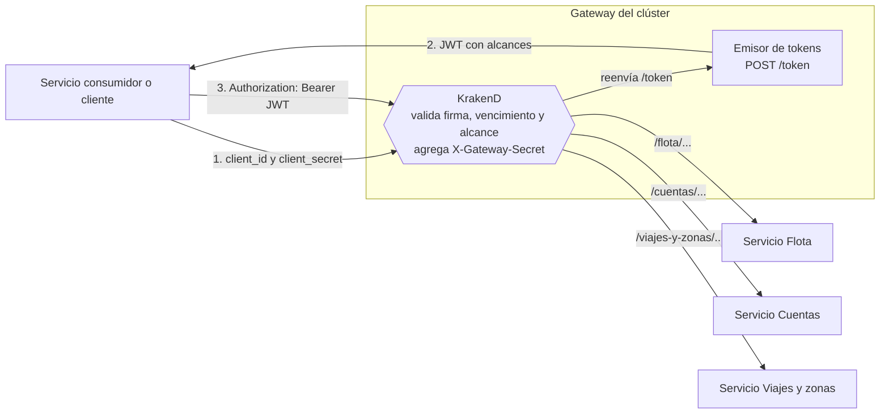
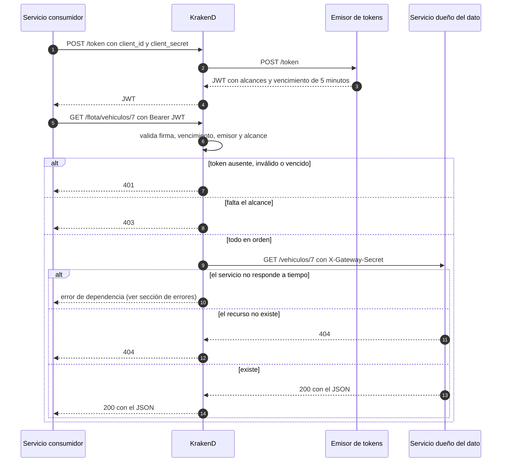

# Guía práctica: el API Gateway del clúster con KrakenD

## Tokens con alcances, enrutamiento desde los contratos OpenAPI y despliegue por pull request

---

> **Nota para el profesor (borrar antes de publicar).** Estado de verificación de esta guía:
>
> - **Probado por mí, ejecutando el código:** el emisor de tokens (casos válidos e inválidos), el generador de la configuración a partir de los contratos (rutas, alcances, variables), el verificador de tokens (firma, emisor, audiencia, vencimiento, clave equivocada, `kid` desconocido), el script de pruebas (contra un gateway de juguete con las mismas reglas, incluido el caso del servicio apagado), la validez de los YAML, el `docker-compose.yml` y los dos diagramas.
> - **No ejecutado por mí:** KrakenD en sí. Desde mi entorno no pude descargar su imagen ni compilarlo, así que la configuración que genera el script la escribí siguiendo la documentación oficial, pero **nadie la ha corrido todavía**. Tampoco pude construir las imágenes de Docker ni correr el workflow en GitHub.
> - **Qué probar antes de clase (unos 15 minutos):** (1) que la etiqueta `krakend:2.13` exista y que `krakend check` acepte la configuración; (2) que el script `pruebas-gateway.sh` pase completo contra el gateway real; (3) que el gateway responda lo que esperamos en estos puntos, que son los que más dudas me dejan: la validación de HS256 con `jwk_local_path` y `disable_jwk_security`, que la cabecera `X-Gateway-Secret` llegue al servicio y que las respuestas del servicio (404, 400, 201) pasen intactas; (4) qué código devuelve KrakenD cuando el servicio está apagado (ver la sección 6). El script está hecho para que cualquier desajuste aparezca como un `FALLO` con el código obtenido.

---

## Objetivos de aprendizaje

Con esta guía buscamos que el estudiante logre:

- Explicar qué hace un API Gateway y por qué lo ponemos entre los servicios de un clúster.
- Entender el flujo Client Credentials: cómo un servicio obtiene un token con alcances y cómo el gateway lo valida.
- Generar la configuración del gateway a partir de los contratos OpenAPI, en lugar de escribirla a mano.
- Levantar el gateway en local, probarlo (401, 403, 404, 200) y desplegarlo con un pipeline por pull request.
- Asumir el rol de **líder del gateway** y documentar sus decisiones.

---

## 1. Qué es un API Gateway y qué hace el nuestro

Un API Gateway es la **puerta de entrada única** a un conjunto de servicios. En vez de que cada servicio exponga su propia seguridad y su propia dirección pública, todos los consumidores llaman al gateway, y él decide si la petición pasa y hacia dónde va.

En nuestro proyecto el gateway tiene cuatro trabajos:

| Trabajo | Cómo lo hacemos |
| --- | --- |
| Entregar tokens | Un **emisor de tokens** (servicio pequeño) atiende `POST /token`. El gateway reenvía esa ruta |
| Validar el token | KrakenD comprueba **firma, emisor, audiencia, vencimiento y alcance** de cada petición |
| Enrutar | Cada operación de cada contrato OpenAPI se convierte en una ruta del gateway hacia el servicio dueño |
| Proteger los servicios | Agrega la cabecera secreta `X-Gateway-Secret`; los servicios rechazan lo que no la traiga |

Así se ve el conjunto:



Y así viaja una petición, con los errores que ya definimos en el enunciado:



### ¿Por qué KrakenD?

- Es de código abierto (licencia Apache 2.0), se mantiene activamente y se configura con **un archivo JSON**, ideal para guardarlo en el repositorio del clúster y cambiarlo por pull request.
- Valida tokens JWT con alcances por ruta de forma nativa.
- Es liviano: un único contenedor, sin base de datos.

### ¿Y por qué hay un emisor de tokens aparte?

Porque KrakenD (en su versión gratuita) **valida** tokens pero **no los emite**. Emitirlos es trabajo de un "servidor de autorización". En una empresa sería Keycloak, Microsoft Entra ID u otro. Para el curso usamos uno propio de unas 60 líneas, que además nos deja ver exactamente cómo funciona el flujo Client Credentials sin configurar nada externo.

---

## 2. Piezas del repositorio del clúster

```
repositorio-del-cluster/
├── contratos/                    contratos OpenAPI acordados (uno por servicio)
│   ├── flota.yaml
│   └── cuentas.yaml
├── emisor-tokens/                el servicio que entrega los tokens
│   ├── src/server.js
│   ├── package.json
│   └── Dockerfile
├── gateway/
│   ├── generar-config.js         contratos -> configuración de KrakenD
│   ├── verificar-token.js        para depurar tokens
│   ├── Dockerfile
│   └── salida/                   archivos generados (NO se suben al repositorio)
├── pruebas/
│   └── pruebas-gateway.sh        pruebas 401, 403, 404 y 200
├── .github/workflows/gateway.yml pipeline por pull request
├── docker-compose.yml            para levantar todo en local
├── .env.example                  variables necesarias (el .env real no se sube)
├── .gitignore
├── package.json
└── GATEWAY.md                    quién lidera el gateway y por qué
```

El `.gitignore` debe incluir:

```
node_modules/
.env
gateway/salida/
```

(La carpeta `gateway/salida/` contiene secretos, por eso se genera en cada ejecución y no se sube.)

---

## 3. Requisitos previos

- Node.js 20.6 o superior (para usar `node --env-file`), aunque su servicio esté en Python: el gateway y el emisor de tokens se ejecutan en contenedores y no dependen del lenguaje de su grupo.
- Docker Desktop (o Docker Engine con Docker Compose).
- Los contratos OpenAPI de los servicios del clúster (guía anterior).

Instalación de dependencias de las herramientas de la raíz:

```bash
npm init -y
npm install yaml jose@5
```

- **yaml:** para leer los contratos.
- **jose:** librería para firmar y verificar JWT; la usa el verificador de tokens.

---

## 4. Paso a paso

### Paso 1: los contratos y la convención de nombres

Copien en `contratos/` el contrato de cada servicio. El generador usa el **nombre del archivo** para decidir dos cosas:

| Archivo | Prefijo en el gateway | Variable con la URL del servicio |
| --- | --- | --- |
| `contratos/flota.yaml` | `/flota/...` | `FLOTA_URL` |
| `contratos/cuentas.yaml` | `/cuentas/...` | `CUENTAS_URL` |
| `contratos/viajes-y-zonas.yaml` | `/viajes-y-zonas/...` | `VIAJES_Y_ZONAS_URL` |

Del contrato toma, por cada operación: la **ruta**, el **método**, los **parámetros de consulta** que deben pasar y los **alcances** que exige (`security`). Si una operación no declara `security`, el generador se detiene con un error: ninguna ruta queda desprotegida por olvido. Las operaciones públicas, como `/health`, declaran `security: []`.

### Paso 2: el emisor de tokens

Es un servicio pequeño que implementa el flujo **Client Credentials**: un servicio envía su `client_id` y su `client_secret`, y recibe un JWT firmado con los alcances que tiene permitidos.

```bash
mkdir emisor-tokens && cd emisor-tokens
npm init -y
npm install express jose@5
```

- **express:** el servidor HTTP.
- **jose:** firma el JWT (usamos la versión 5 porque funciona con `require` en todas las versiones de Node).

Archivo `emisor-tokens/src/server.js`:

```javascript
const crypto = require("crypto");
const express = require("express");
const { SignJWT } = require("jose");

const PORT = process.env.PORT || 4000;
const JWT_SECRET = process.env.JWT_SECRET;
const ISSUER = process.env.JWT_ISSUER || "emisor-cluster";
const AUDIENCE = process.env.JWT_AUDIENCE || "cluster";
const KID = process.env.JWT_KID || "clave-1";
const EXPIRA_SEG = Number(process.env.TOKEN_EXPIRA_SEG || 300);

// Clientes permitidos: { "flota-mid": { "secret": "...", "scopes": ["vehiculos:leer"] }, ... }
const CLIENTES = JSON.parse(process.env.CLIENTES_JSON || "{}");

if (!JWT_SECRET || JWT_SECRET.length < 32) {
  console.error("JWT_SECRET es obligatorio y debe tener al menos 32 caracteres");
  process.exit(1);
}
const clave = new TextEncoder().encode(JWT_SECRET);

const app = express();
app.use(express.urlencoded({ extended: false }));
app.use(express.json());

const error = (res, status, codigo, descripcion) =>
  res.status(status).json({ error: codigo, error_description: descripcion });

const iguales = (a, b) => {
  const x = Buffer.from(String(a));
  const y = Buffer.from(String(b));
  return x.length === y.length && crypto.timingSafeEqual(x, y);
};

app.get("/health", (req, res) => res.json({ estado: "ok" }));

// Flujo Client Credentials (RFC 6749, sección 4.4).
app.post("/token", async (req, res) => {
  let { grant_type, client_id, client_secret, scope } = req.body || {};

  // También se admite HTTP Basic: Authorization: Basic base64(client_id:client_secret)
  const basic = req.get("Authorization");
  if (basic && basic.startsWith("Basic ")) {
    const [id, ...resto] = Buffer.from(basic.slice(6), "base64").toString().split(":");
    client_id = client_id || id;
    client_secret = client_secret || resto.join(":");
  }

  if (grant_type !== "client_credentials") {
    return error(res, 400, "unsupported_grant_type", "Solo se admite client_credentials");
  }
  const cliente = CLIENTES[client_id];
  if (!cliente || !client_secret || !iguales(cliente.secret, client_secret)) {
    return error(res, 401, "invalid_client", "Credenciales inválidas");
  }

  // Alcances pedidos (opcionales): deben ser un subconjunto de los permitidos al cliente.
  const pedidos = scope ? String(scope).split(" ").filter(Boolean) : cliente.scopes;
  const noPermitidos = pedidos.filter((s) => !cliente.scopes.includes(s));
  if (noPermitidos.length > 0) {
    return error(res, 400, "invalid_scope", `Alcances no permitidos: ${noPermitidos.join(" ")}`);
  }

  const token = await new SignJWT({ scope: pedidos.join(" ") })
    .setProtectedHeader({ alg: "HS256", kid: KID })
    .setIssuer(ISSUER)
    .setAudience(AUDIENCE)
    .setSubject(client_id)
    .setIssuedAt()
    .setExpirationTime(`${EXPIRA_SEG}s`)
    .sign(clave);

  res.set("Cache-Control", "no-store").json({
    access_token: token,
    token_type: "Bearer",
    expires_in: EXPIRA_SEG,
    scope: pedidos.join(" "),
  });
});

app.listen(PORT, () => console.log(`Emisor de tokens escuchando en el puerto ${PORT}`));
```

Puntos clave:

- **Quién puede pedir tokens** se define en la variable `CLIENTES_JSON`: cada cliente con su secreto y la lista de alcances que se le permiten. El líder del gateway administra este archivo (como secreto, nunca en el repositorio).
- El token lleva el alcance en el campo `scope` (texto con los alcances separados por espacios, como pide el estándar OAuth2) y el encabezado `kid`, que identifica con qué clave se firmó.
- Si el cliente pide alcances que no tiene permitidos, el emisor responde 400 `invalid_scope`; si las credenciales fallan, 401 `invalid_client`.
- Los tokens duran 5 minutos (`TOKEN_EXPIRA_SEG`). Por eso un consumidor debe saber **renovar el token cuando recibe un 401** (ya lo definimos en el enunciado).

Archivo `emisor-tokens/Dockerfile`:

```dockerfile
FROM node:20-alpine
WORKDIR /app
COPY package*.json ./
RUN npm ci --omit=dev
COPY src ./src
EXPOSE 4000
CMD ["node", "src/server.js"]
```

### Paso 3: el generador de la configuración

KrakenD se configura con un archivo `krakend.json`. Escribirlo a mano para decenas de operaciones es lento y propenso a errores. Como los contratos ya dicen todo lo necesario, un script lo genera.

Archivo `gateway/generar-config.js`:

```javascript
// Genera la configuración de KrakenD a partir de los contratos OpenAPI.
//   contratos/flota.yaml  ->  prefijo /flota, destino en la variable FLOTA_URL
//   contratos/viajes-y-zonas.yaml -> prefijo /viajes-y-zonas, variable VIAJES_Y_ZONAS_URL
// Uso: node gateway/generar-config.js
const fs = require("fs");
const path = require("path");
const crypto = require("crypto");
const YAML = require("yaml");

const DIR_CONTRATOS = path.join(__dirname, "..", "contratos");
const DIR_SALIDA = path.join(__dirname, "salida");
const METODOS = ["get", "post", "put", "patch", "delete"];

function requerida(nombre) {
  const valor = process.env[nombre];
  if (!valor) faltantes.push(nombre);
  return valor;
}
const faltantes = [];

const JWT_SECRET = requerida("JWT_SECRET");
const GATEWAY_SECRET = requerida("GATEWAY_SECRET");
const EMISOR_URL = requerida("EMISOR_URL");
const ISSUER = process.env.JWT_ISSUER || "emisor-cluster";
const AUDIENCE = process.env.JWT_AUDIENCE || "cluster";
const KID = process.env.JWT_KID || "clave-1";

const archivos = fs.readdirSync(DIR_CONTRATOS).filter((f) => f.endsWith(".yaml"));
const servicios = archivos.map((archivo) => {
  const nombre = path.basename(archivo, ".yaml");
  const variable = nombre.toUpperCase().replace(/-/g, "_") + "_URL";
  return { nombre, variable, url: requerida(variable), contrato: YAML.parse(fs.readFileSync(path.join(DIR_CONTRATOS, archivo), "utf8")) };
});

if (faltantes.length > 0) {
  console.error("Faltan variables de entorno: " + faltantes.join(", "));
  process.exit(1);
}

const rutaKrakend = (ruta) => ruta; // OpenAPI y KrakenD usan la misma forma: /vehiculos/{id}

function alcancesDe(operacion, contrato) {
  const seguridad = operacion.security ?? contrato.security;
  if (!seguridad) throw new Error(`La operación ${operacion.operationId} no declara security`);
  if (seguridad.length === 0) return null; // pública
  return Object.values(seguridad[0])[0]; // lista de alcances del primer requisito
}

const endpoints = [];

// 1. Ruta pública para pedir tokens (la atiende el emisor de tokens).
endpoints.push({
  endpoint: "/token",
  method: "POST",
  output_encoding: "no-op",
  input_headers: ["Content-Type", "Authorization"],
  backend: [{ host: [EMISOR_URL], url_pattern: "/token", encoding: "no-op" }],
});

// 2. Una ruta por cada operación de cada contrato.
for (const s of servicios) {
  for (const [ruta, item] of Object.entries(s.contrato.paths)) {
    for (const metodo of METODOS.filter((m) => item[m])) {
      const operacion = item[metodo];
      const alcances = alcancesDe(operacion, s.contrato);
      const consultas = [...(item.parameters || []), ...(operacion.parameters || [])]
        .filter((p) => p.in === "query")
        .map((p) => p.name);

      const endpoint = {
        endpoint: `/${s.nombre}${rutaKrakend(ruta)}`,
        method: metodo.toUpperCase(),
        output_encoding: "no-op",
        input_headers: ["Content-Type"],
        input_query_strings: consultas,
        backend: [
          {
            host: [s.url],
            url_pattern: rutaKrakend(ruta),
            encoding: "no-op",
            extra_config: {
              "modifier/martian": {
                "header.Modifier": { scope: ["request"], name: "X-Gateway-Secret", value: GATEWAY_SECRET },
              },
            },
          },
        ],
      };

      if (alcances) {
        endpoint.extra_config = {
          "auth/validator": {
            alg: "HS256",
            jwk_local_path: "/etc/krakend/jwks.json",
            disable_jwk_security: true,
            audience: [AUDIENCE],
            issuer: ISSUER,
            scopes_key: "scope",
            scopes_matcher: "all",
            scopes: alcances,
          },
        };
      }
      endpoints.push(endpoint);
    }
  }
}

const config = {
  $schema: "https://www.krakend.io/schema/krakend.json",
  version: 3,
  name: "Gateway del clúster",
  port: 8080,
  timeout: "3s",
  endpoints,
};

// 3. El conjunto de claves (JWK) con la que el gateway verifica la firma de los tokens.
const jwks = { keys: [{ kty: "oct", kid: KID, alg: "HS256", use: "sig", k: Buffer.from(JWT_SECRET).toString("base64url") }] };

fs.mkdirSync(DIR_SALIDA, { recursive: true });
fs.writeFileSync(path.join(DIR_SALIDA, "krakend.json"), JSON.stringify(config, null, 2));
fs.writeFileSync(path.join(DIR_SALIDA, "jwks.json"), JSON.stringify(jwks, null, 2));
console.log(`Listo: ${endpoints.length} rutas (${servicios.map((s) => s.nombre).join(", ")}) en gateway/salida/`);
```

El script produce dos archivos en `gateway/salida/`:

- `krakend.json`: la configuración del gateway.
- `jwks.json`: el conjunto de claves con el que el gateway verifica la firma de los tokens (se construye con `JWT_SECRET`).

Así queda una ruta generada (por ejemplo, `POST /flota/vehiculos`), que conviene leer línea a línea:

```json
{
  "endpoint": "/flota/vehiculos",
  "method": "POST",
  "output_encoding": "no-op",
  "input_headers": [
    "Content-Type"
  ],
  "input_query_strings": [],
  "backend": [
    {
      "host": [
        "http://flota:3000"
      ],
      "url_pattern": "/vehiculos",
      "encoding": "no-op",
      "extra_config": {
        "modifier/martian": {
          "header.Modifier": {
            "scope": [
              "request"
            ],
            "name": "X-Gateway-Secret",
            "value": "(el secreto del gateway)"
          }
        }
      }
    }
  ],
  "extra_config": {
    "auth/validator": {
      "alg": "HS256",
      "jwk_local_path": "/etc/krakend/jwks.json",
      "disable_jwk_security": true,
      "audience": [
        "cluster"
      ],
      "issuer": "emisor-cluster",
      "scopes_key": "scope",
      "scopes_matcher": "all",
      "scopes": [
        "vehiculos:escribir"
      ]
    }
  }
}
```

| Campo | Qué hace |
| --- | --- |
| `endpoint` y `method` | La ruta que el gateway expone hacia afuera |
| `output_encoding` y `encoding` en `no-op` | El gateway **no interpreta ni modifica** el cuerpo: devuelve tal cual lo que respondió el servicio (con su código de estado) |
| `input_headers` | **Lista blanca** de cabeceras que se reenvían al servicio. Como `X-Gateway-Secret` no está aquí, un cliente no puede enviarla por su cuenta: solo existe la que agrega el gateway |
| `input_query_strings` | Parámetros de consulta que se reenvían (salen del contrato) |
| `backend.host` y `url_pattern` | A dónde va la petición (`FLOTA_URL` más la ruta del contrato) |
| `modifier/martian` con `header.Modifier` | Agrega la cabecera `X-Gateway-Secret` en la petición hacia el servicio |
| `auth/validator` | Valida el JWT: algoritmo, archivo de claves, emisor, audiencia y **alcances** (`scopes_matcher: all` exige todos los alcances de la lista) |

### Paso 4: variables de entorno

Archivo `.env.example` (copien como `.env`, que no se sube):

```
# Copien este archivo como .env (el .env NO se sube al repositorio)
JWT_SECRET=cambien-esto-por-una-clave-larga-de-al-menos-32-caracteres
GATEWAY_SECRET=cambien-esto-por-otro-secreto
JWT_ISSUER=emisor-cluster
JWT_AUDIENCE=cluster

# A dónde enruta el gateway (una variable por contrato en /contratos)
EMISOR_URL=http://emisor:4000
FLOTA_URL=http://flota:3000
CUENTAS_URL=http://cuentas:3002

# Quién puede pedir tokens y con qué alcances (una sola línea)
CLIENTES_JSON='{"viajes-mid":{"secret":"secreto-viajes","scopes":["vehiculos:leer","vehiculos:escribir","usuarios:leer"]},"lector":{"secret":"secreto-lector","scopes":["vehiculos:leer"]}}'
```

- `JWT_SECRET` firma los tokens y se usa para generar `jwks.json`: mínimo 32 caracteres.
- `GATEWAY_SECRET` es el secreto que **los servicios** deben exigir en la cabecera `X-Gateway-Secret`. Cada grupo lo recibe del líder y lo configura en su servicio como variable de entorno.
- Cada contrato en `contratos/` necesita su `<NOMBRE>_URL`.
- Si falta alguna, el generador lo dice y se detiene.

Agreguen estos scripts en el `package.json` de la raíz:

```json
"scripts": {
  "config": "node --env-file=.env gateway/generar-config.js",
  "verificar-token": "node --env-file=.env gateway/verificar-token.js",
  "pruebas": "./pruebas/pruebas-gateway.sh"
}
```

Y generen la configuración:

```bash
npm run config
# Listo: 9 rutas (cuentas, flota) en gateway/salida/
```

### Paso 5: el contenedor del gateway

Archivo `gateway/Dockerfile`:

```dockerfile
FROM krakend:2.13
COPY salida/krakend.json /etc/krakend/krakend.json
COPY salida/jwks.json /etc/krakend/jwks.json
```

Simplemente copia la configuración generada dentro de la imagen oficial de KrakenD.

**Una simplificación que debemos reconocer:** como `krakend.json` lleva el secreto del gateway y `jwks.json` la clave de firma, la imagen contiene secretos. Aceptamos esto para el curso **siempre que la imagen esté en un registro privado** (por ejemplo, un Azure Container Registry privado) y nunca en uno público. En un entorno real, esos valores vendrían de un gestor de secretos como Azure Key Vault.

### Paso 6: levantar todo en local

Archivo `docker-compose.yml`:

```yaml
services:
  emisor:
    build: ./emisor-tokens
    environment:
      JWT_SECRET: ${JWT_SECRET}
      JWT_ISSUER: ${JWT_ISSUER}
      JWT_AUDIENCE: ${JWT_AUDIENCE}
      CLIENTES_JSON: ${CLIENTES_JSON}

  gateway:
    build: ./gateway          # usa gateway/salida/, que genera "npm run config"
    ports:
      - "8080:8080"
    depends_on:
      - emisor
      - flota

  flota:                      # el servicio de un grupo (ajusten la ruta a su repositorio)
    build: ../flota-api
    environment:
      GATEWAY_SECRET: ${GATEWAY_SECRET}
      PORT: "3000"
```

El servicio `flota` es un ejemplo: ajusten la ruta `build` al repositorio de su grupo (o cambien por la imagen publicada del servicio). Cada servicio del clúster que quieran probar se agrega igual, con su `GATEWAY_SECRET`.

```bash
npm run config
docker compose up --build
```

El gateway queda en `http://localhost:8080`. KrakenD también expone `/__health` para saber si el propio gateway está vivo.

### Paso 7: probar a mano

```bash
# 1. Pedir un token (Client Credentials)
curl -s -d 'grant_type=client_credentials&client_id=viajes-mid&client_secret=secreto-viajes' \
  http://localhost:8080/token
# {"access_token":"eyJ...","token_type":"Bearer","expires_in":300,"scope":"vehiculos:leer vehiculos:escribir usuarios:leer"}

# 2. Usarlo
TOKEN=eyJ...   # peguen el access_token
curl -H "Authorization: Bearer $TOKEN" http://localhost:8080/flota/vehiculos

# 3. Sin token: 401
curl -i http://localhost:8080/flota/vehiculos

# 4. Un vehículo que no existe: 404, que responde el servicio dueño del dato
curl -i -H "Authorization: Bearer $TOKEN" http://localhost:8080/flota/vehiculos/zzz
```

**Cuando algo falla, depuren el token.** El verificador hace con el token lo mismo que el gateway:

```bash
npm run verificar-token -- "$TOKEN" vehiculos:escribir
# Firma, emisor, audiencia y vencimiento: VALIDOS
# Cliente: viajes-mid | vence: 2026-11-18T15:05:56.000Z
# Alcances: vehiculos:leer, vehiculos:escribir, usuarios:leer
# Alcance vehiculos:escribir: PRESENTE (200)
```

Si el alcance dice `AUSENTE (403)`, ya saben por qué el gateway lo rechaza. Y si el token está vencido, manipulado o firmado con otra clave, el verificador lo dice con la causa (por ejemplo, `ERR_JWT_EXPIRED`).

Archivo `gateway/verificar-token.js`:

```javascript
// Comprueba un token contra gateway/salida/jwks.json, igual que lo haría el gateway.
// Uso: node gateway/verificar-token.js <token> [alcance-requerido]
const fs = require("fs");
const path = require("path");
const { decodeProtectedHeader, importJWK, jwtVerify } = require("jose");

const [token, requerido] = process.argv.slice(2);
if (!token) {
  console.error("Uso: node gateway/verificar-token.js <token> [alcance-requerido]");
  process.exit(1);
}
const jwks = JSON.parse(fs.readFileSync(path.join(__dirname, "salida", "jwks.json"), "utf8"));

// Se busca en el conjunto de claves la que coincide con el "kid" del encabezado del token.
const buscarClave = async () => {
  const { kid } = decodeProtectedHeader(token);
  const jwk = jwks.keys.find((k) => k.kid === kid);
  if (!jwk) throw Object.assign(new Error("kid desconocido"), { code: "KID_DESCONOCIDO" });
  return importJWK(jwk, "HS256");
};

buscarClave()
  .then((clave) =>
    jwtVerify(token, clave, {
      issuer: process.env.JWT_ISSUER || "emisor-cluster",
      audience: process.env.JWT_AUDIENCE || "cluster",
    })
  )
  .then(({ payload }) => {
    const alcances = String(payload.scope || "").split(" ");
    console.log("Firma, emisor, audiencia y vencimiento: VALIDOS");
    console.log("Cliente:", payload.sub, "| vence:", new Date(payload.exp * 1000).toISOString());
    console.log("Alcances:", alcances.join(", "));
    if (requerido) console.log(`Alcance ${requerido}:`, alcances.includes(requerido) ? "PRESENTE (200)" : "AUSENTE (403)");
  })
  .catch((e) => {
    console.log("Token RECHAZADO (401):", e.code || e.message);
    process.exit(2);
  });
```

### Paso 8: las pruebas automáticas

El script `pruebas/pruebas-gateway.sh` cubre los casos que más nos interesan: 401, 403, 404 y 200. Necesita dos clientes de prueba en `CLIENTES_JSON`: uno que puede escribir (`viajes-mid`) y otro que solo puede leer (`lector`).

```bash
#!/usr/bin/env bash
# Pruebas de humo del gateway: los casos 401, 403, 404 y 200.
# Uso: GATEWAY=http://localhost:8080 ./pruebas/pruebas-gateway.sh
GATEWAY="${GATEWAY:-http://localhost:8080}"
# Clientes de prueba (deben existir en CLIENTES_JSON del emisor de tokens)
ESCRITOR_ID="${ESCRITOR_ID:-viajes-mid}";  ESCRITOR_SECRET="${ESCRITOR_SECRET:-secreto-viajes}"
LECTOR_ID="${LECTOR_ID:-lector}";          LECTOR_SECRET="${LECTOR_SECRET:-secreto-lector}"

fallos=0
verificar() {  # verificar "descripción" esperado obtenido
  if [ "$2" = "$3" ]; then echo "OK     $1 (HTTP $3)"; else echo "FALLO  $1 (esperado $2, obtenido $3)"; fallos=$((fallos+1)); fi
}
estado() { curl -s -o /dev/null -w '%{http_code}' "$@"; }
pedir_token() {  # pedir_token client_id client_secret
  curl -s -d "grant_type=client_credentials&client_id=$1&client_secret=$2" "$GATEWAY/token" \
    | sed -n 's/.*"access_token":"\([^"]*\)".*/\1/p'
}

TOKEN_ESCRITOR=$(pedir_token "$ESCRITOR_ID" "$ESCRITOR_SECRET")
TOKEN_LECTOR=$(pedir_token "$LECTOR_ID" "$LECTOR_SECRET")
[ -z "$TOKEN_ESCRITOR" ] && echo "No se pudo obtener el token del escritor: revisen el emisor de tokens" && exit 1
[ -z "$TOKEN_LECTOR" ] && echo "No se pudo obtener el token del lector: revisen el emisor de tokens" && exit 1

JSON='Content-Type: application/json'
NUEVO='{"tipo":"scooter","bateriaPct":60}'

echo "--- Tokens"
verificar "Pedir token con credenciales malas" 401 "$(estado -d 'grant_type=client_credentials&client_id=x&client_secret=y' "$GATEWAY/token")"

echo "--- 401: el gateway rechaza"
verificar "Ruta protegida sin token" 401 "$(estado "$GATEWAY/flota/vehiculos")"
verificar "Ruta protegida con token inventado" 401 "$(estado -H 'Authorization: Bearer inventado' "$GATEWAY/flota/vehiculos")"

echo "--- 403: token válido, pero sin el alcance"
verificar "Crear con token de solo lectura" 403 "$(estado -X POST -H "Authorization: Bearer $TOKEN_LECTOR" -H "$JSON" -d "$NUEVO" "$GATEWAY/flota/vehiculos")"

echo "--- 200, 201 y 404"
verificar "Ruta pública (health)" 200 "$(estado "$GATEWAY/flota/health")"
verificar "Listar con token de lectura" 200 "$(estado -H "Authorization: Bearer $TOKEN_LECTOR" "$GATEWAY/flota/vehiculos")"
verificar "Crear con token de escritura" 201 "$(estado -X POST -H "Authorization: Bearer $TOKEN_ESCRITOR" -H "$JSON" -d "$NUEVO" "$GATEWAY/flota/vehiculos")"
verificar "Vehículo inexistente (404 del servicio dueño)" 404 "$(estado -H "Authorization: Bearer $TOKEN_LECTOR" "$GATEWAY/flota/vehiculos/zzz")"
verificar "Dato inválido (400 del servicio)" 400 "$(estado -X POST -H "Authorization: Bearer $TOKEN_ESCRITOR" -H "$JSON" -d '{"tipo":"scooter","bateriaPct":500}' "$GATEWAY/flota/vehiculos")"

if [ -n "$FLOTA_DIRECTO" ]; then
  echo "--- Llamada directa al servicio, saltándose el gateway"
  verificar "Servicio sin la cabecera del gateway" 403 "$(estado "$FLOTA_DIRECTO/vehiculos")"
fi

echo
echo "Falta una prueba manual: apaguen el servicio Flota y repitan un GET con token. Esperado: 503 (ver sección de errores)."
[ "$fallos" -eq 0 ] && echo "Todas las pruebas automáticas pasaron." || { echo "$fallos prueba(s) fallaron."; exit 1; }
```

Ejecútenlo con el gateway levantado:

```bash
npm run pruebas
# o, probando también que el servicio rechaza llamadas directas:
FLOTA_DIRECTO=http://localhost:3000 npm run pruebas
```

La salida correcta:

```
--- Tokens
OK     Pedir token con credenciales malas (HTTP 401)
--- 401: el gateway rechaza
OK     Ruta protegida sin token (HTTP 401)
OK     Ruta protegida con token inventado (HTTP 401)
--- 403: token válido, pero sin el alcance
OK     Crear con token de solo lectura (HTTP 403)
--- 200, 201 y 404
OK     Ruta pública (health) (HTTP 200)
OK     Listar con token de lectura (HTTP 200)
OK     Crear con token de escritura (HTTP 201)
OK     Vehículo inexistente (404 del servicio dueño) (HTTP 404)
OK     Dato inválido (400 del servicio) (HTTP 400)
Todas las pruebas automáticas pasaron.
```

---

## 5. Qué produce cada respuesta de error

Recordemos la tabla del enunciado y cómo se refleja aquí:

| Código | Lo produce | Cómo se provoca en la prueba |
| --- | --- | --- |
| 401 | **El gateway** | Sin token, token inventado, vencido o firmado con otra clave |
| 403 | **El gateway** | Token válido, pero sin el alcance que exige la ruta |
| 404 | **El servicio dueño del dato** | Pedir un recurso que no existe; el gateway lo deja pasar intacto |
| 400 | **El servicio** | Datos que incumplen el contrato; también pasa intacto |

Nota sobre los cuerpos: cuando el **gateway** rechaza con 401 o 403, la respuesta puede venir **sin cuerpo JSON** (a diferencia de los errores de los servicios, que siguen el formato `codigo` y `mensaje`). Verifiquen qué devuelve su versión y, si es así, declárenlo en el contrato del gateway: para esos dos códigos, el consumidor se guía por el **código de estado**, no por el cuerpo.

---

## 6. El caso del 503 (servicio caído)

Este es el que más nos importa en la demostración. Con todo levantado, apaguen el servicio Flota y repitan una consulta:

```bash
docker compose stop flota
curl -i -H "Authorization: Bearer $TOKEN" http://localhost:8080/flota/vehiculos
```

El enunciado dice que el consumidor debe tratar esto como un **503** y devolver su propio 503 a su cliente. Lo que devuelve KrakenD cuando no logra conectar con el servicio (o cuando se agota el tiempo, `timeout: 3s`) puede ser 500, 503 o 504 según el caso y la versión. **Regla del clúster:** el MID consumidor trata **cualquier 5xx del gateway** como "dependencia no disponible", reintenta con límite y, si no responde, devuelve su propio 503. Así no importa cuál de los tres salga. Si quieren que el gateway devuelva exactamente 503, el líder lo investiga, lo ajusta y lo documenta en `GATEWAY.md`.

---

## 7. El rol del líder del gateway

El enunciado pide que una persona del clúster sea la **líder del gateway** y que eso quede justificado. En concreto, el líder:

- **Administra los clientes:** decide quién puede pedir tokens y con qué alcances (`CLIENTES_JSON`), y entrega a cada grupo sus credenciales por un canal privado.
- **Guarda los secretos** (`JWT_SECRET`, `GATEWAY_SECRET`) como secretos de GitHub y de la plataforma, y los rota si se filtran.
- **Revisa los pull requests** que tocan `contratos/` o `gateway/`, junto con los grupos afectados.
- **Resuelve** las fallas de integración entre grupos: es el primer punto de contacto.
- **Mantiene** la colección de pruebas y el diagrama de arquitectura.

Todo esto se reparte en el tablero Scrumban y se entrega por pull request: liderar no es hacer todo solo.

Plantilla para `GATEWAY.md`:

```markdown
# Gateway del clúster [nombre]

## Líder
- Nombre: ...
- Por qué se eligió: (experiencia, disponibilidad, acuerdo del clúster, la razón que sea, pero explicada)
- Reemplazo si no está disponible: ...

## Responsabilidades
- ...

## Decisiones tomadas
| Fecha | Decisión | Por qué |
| --- | --- | --- |
| ... | Alcances por servicio: ... | ... |
| ... | Duración del token: 5 minutos | ... |

## Cómo se toman las decisiones
(por ejemplo: cambios por pull request, aprobados por el líder y por un representante de cada grupo afectado)

## Clientes registrados
| client_id | Servicio | Alcances |
| --- | --- | --- |
| ... | ... | ... |
(Los secretos NO se escriben aquí.)
```

---

## 8. Despliegue

**La plataforma es libre** (Azure App Service, Azure Container Apps, Azure Container Instances u otra). Lo que necesitan:

- **Dos servicios desplegados:** el **gateway** (KrakenD, puerto 8080) y el **emisor de tokens** (puerto 4000). Los servicios de los grupos se despliegan como siempre.
- **HTTPS en el gateway.** Los tokens viajan en las cabeceras, así que el gateway debe estar detrás de HTTPS. App Service y Container Apps lo dan automáticamente con su dominio; ACI no, por eso les recomendamos una de las dos primeras para el gateway.
- **Variables de entorno de cada servicio:** el emisor necesita `JWT_SECRET`, `JWT_ISSUER`, `JWT_AUDIENCE` y `CLIENTES_JSON`. Los servicios de los grupos necesitan `GATEWAY_SECRET`. El gateway no usa variables en ejecución: su configuración ya viene generada dentro de la imagen.
- **Las URLs que usa el gateway** (`FLOTA_URL`, etc.) son las que entrega la plataforma a cada servicio. Si un servicio cambia de dirección, se actualiza la variable y el pipeline vuelve a generar la configuración.
- **Registro privado** para las imágenes (por ejemplo, Azure Container Registry), por lo dicho en el paso 5.

---

## 9. El pipeline, por pull request

Recuerden la regla: **ningún workflow se dispara por `push`**. Este tiene dos trabajos:

- **`validar`**, mientras el pull request está abierto o se actualiza: valida los contratos con el linter de la guía anterior, genera la configuración y comprueba que KrakenD la acepta (`krakend check`). Si falla, el pull request no se puede fusionar.
- **`desplegar`**, solo cuando el pull request se **aprobó y se fusionó** a `main`: construye las imágenes, las publica en el registro y las despliega.

Archivo `.github/workflows/gateway.yml`:

```yaml
name: Gateway del clúster

# Todo se dispara por pull request, nunca por push.
on:
  pull_request:
    branches: [main]
    types: [opened, synchronize, reopened, closed]

env:
  REGISTRO: ${{ vars.ACR_NOMBRE }}.azurecr.io

jobs:
  validar:
    # Mientras el pull request está abierto o se actualiza
    if: github.event.action != 'closed'
    runs-on: ubuntu-latest
    steps:
      - uses: actions/checkout@v4
      - uses: actions/setup-node@v4
        with:
          node-version: 20
      - name: Validar los contratos
        run: |
          npm install --no-save @stoplight/spectral-cli
          npx spectral lint "contratos/*.yaml"
      - name: Generar la configuración del gateway
        run: |
          npm ci
          node gateway/generar-config.js
        env:
          JWT_SECRET: ${{ secrets.JWT_SECRET }}
          GATEWAY_SECRET: ${{ secrets.GATEWAY_SECRET }}
          EMISOR_URL: ${{ vars.EMISOR_URL }}
          FLOTA_URL: ${{ vars.FLOTA_URL }}
          CUENTAS_URL: ${{ vars.CUENTAS_URL }}
      - name: Verificar la configuración con KrakenD
        run: |
          docker run --rm -v "$PWD/gateway/salida:/etc/krakend" krakend:2.13 \
            krakend check -c /etc/krakend/krakend.json

  desplegar:
    # Solo cuando el pull request se aprobó y se fusionó a main
    if: github.event.pull_request.merged == true
    runs-on: ubuntu-latest
    steps:
      - uses: actions/checkout@v4
      - uses: actions/setup-node@v4
        with:
          node-version: 20
      - name: Generar la configuración del gateway
        run: |
          npm ci
          node gateway/generar-config.js
        env:
          JWT_SECRET: ${{ secrets.JWT_SECRET }}
          GATEWAY_SECRET: ${{ secrets.GATEWAY_SECRET }}
          EMISOR_URL: ${{ vars.EMISOR_URL }}
          FLOTA_URL: ${{ vars.FLOTA_URL }}
          CUENTAS_URL: ${{ vars.CUENTAS_URL }}
      - uses: azure/login@v2
        with:
          creds: ${{ secrets.AZURE_CREDENTIALS }}
      - name: Construir y publicar las imágenes
        run: |
          az acr login --name ${{ vars.ACR_NOMBRE }}
          docker build -t $REGISTRO/gateway:${{ github.sha }} ./gateway
          docker build -t $REGISTRO/emisor-tokens:${{ github.sha }} ./emisor-tokens
          docker push $REGISTRO/gateway:${{ github.sha }}
          docker push $REGISTRO/emisor-tokens:${{ github.sha }}
      # El último paso depende de la plataforma que elijan. Con Azure Container Apps sería:
      - name: Desplegar
        run: |
          az containerapp update -n gateway -g ${{ vars.GRUPO_RECURSOS }} \
            --image $REGISTRO/gateway:${{ github.sha }}
          az containerapp update -n emisor-tokens -g ${{ vars.GRUPO_RECURSOS }} \
            --image $REGISTRO/emisor-tokens:${{ github.sha }}
```

Configuración necesaria en GitHub (en Settings, Secrets and variables, Actions):

| Tipo | Nombre | Para qué |
| --- | --- | --- |
| Secreto | `JWT_SECRET`, `GATEWAY_SECRET` | Firma de tokens y secreto de los servicios |
| Secreto | `AZURE_CREDENTIALS` | Credenciales para publicar y desplegar en Azure |
| Variable | `EMISOR_URL`, `FLOTA_URL`, `CUENTAS_URL`, ... | Direcciones de cada servicio |
| Variable | `ACR_NOMBRE`, `GRUPO_RECURSOS` | Registro y grupo de recursos de Azure |

Además, activen la **protección de la rama `main`**: pull request obligatorio, con al menos una aprobación, y el trabajo `validar` como verificación requerida. El último paso del trabajo `desplegar` depende de su plataforma; el del ejemplo es para Azure Container Apps y deben adaptarlo a la suya.

---

## 10. Cómo agregar un servicio nuevo al clúster

1. El grupo propone su contrato en `contratos/<nombre>.yaml` (con `security` en cada operación), por pull request.
2. Los grupos que lo consumirán lo revisan y aprueban, y el líder también.
3. El líder agrega la variable `<NOMBRE>_URL` (en `.env` local y en las variables de GitHub).
4. Si el servicio consume a otros, el líder registra su cliente en `CLIENTES_JSON` con los alcances que necesita, y el grupo recibe sus credenciales.
5. Al fusionar, el pipeline regenera la configuración y redespliega el gateway.
6. El grupo configura `GATEWAY_SECRET` en su servicio y agrega sus casos a las pruebas.

---

## 11. Problemas frecuentes

| Síntoma | Causa habitual | Qué hacer |
| --- | --- | --- |
| `Faltan variables de entorno: ...` al generar | Falta la `<NOMBRE>_URL` de algún contrato | Agréguenla al `.env` o a las variables de GitHub |
| 401 con un token que parece bueno | Token vencido (duran 5 minutos), o `JWT_SECRET` distinto entre emisor y gateway | `npm run verificar-token`; regeneren la configuración con el mismo secreto |
| 403 en una ruta que debería funcionar | El cliente no tiene el alcance en `CLIENTES_JSON`, o el contrato lo exige distinto | Comparen los alcances del token con los del contrato |
| 403 con mensaje `no_gateway` en el servicio | El `GATEWAY_SECRET` del servicio no coincide con el del gateway | Deben ser exactamente iguales |
| 404 en una ruta que sí existe | El contrato no está en `contratos/`, o la ruta no coincide | Regeneren la configuración y revisen el prefijo (nombre del archivo) |
| Cambié el contrato y el gateway no lo refleja | El gateway lleva la configuración dentro de la imagen | Regeneren, reconstruyan la imagen y redespliegen (lo hace el pipeline al fusionar) |
| Un parámetro de consulta no llega al servicio | No está declarado en el contrato | Agréguenlo como parámetro `in: query` y regeneren |
| El pipeline no corre | Solo corre en pull request hacia `main` | Abran el pull request; no hagan push directo |

---

## 12. Lista de verificación para el proyecto

- [ ] Líder designado y `GATEWAY.md` con su justificación.
- [ ] Un contrato por servicio en `contratos/`, con `security` en cada operación.
- [ ] El emisor de tokens responde 401 con credenciales malas y 400 con alcances no permitidos.
- [ ] El gateway genera su configuración desde los contratos (sin editar `krakend.json` a mano).
- [ ] Las pruebas automáticas pasan: 401, 403, 404, 400 y 200.
- [ ] Los servicios rechazan llamadas directas (sin `X-Gateway-Secret`).
- [ ] Se probó el caso del servicio apagado y los MID responden su propio 503.
- [ ] Los secretos están en GitHub Secrets y en la plataforma, nunca en el repositorio; las imágenes, en un registro privado.
- [ ] El pipeline corre solo por pull request y despliega al fusionar.
- [ ] El diagrama de arquitectura incluye el gateway y el emisor de tokens.

---

## Cierre y siguientes pasos

Con esto tienen el gateway completo de un clúster: tokens con alcances, enrutamiento generado desde los contratos y despliegue automatizado. Si prefieren no depender de KrakenD, la guía siguiente muestra cómo construir un gateway propio mínimo que hace lo mismo con unas 150 líneas de código.

Electiva de Desarrollo Web Backend
