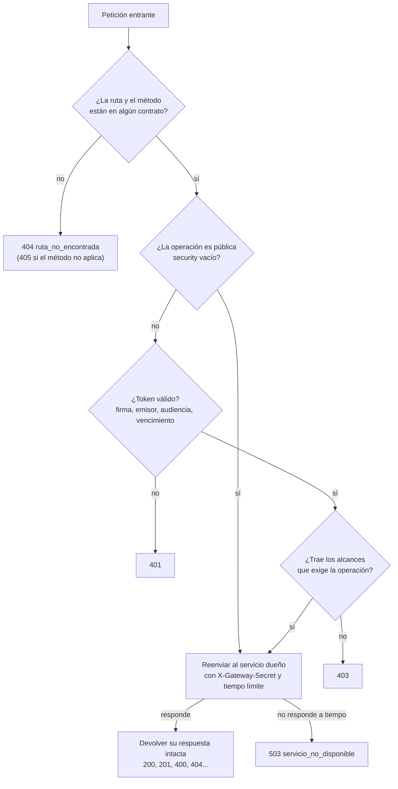

# Guía práctica: construir un API Gateway propio

## Un gateway de unas 150 líneas, en Node con Express o en Python con FastAPI

---

## Objetivos de aprendizaje

Con esta guía buscamos que el estudiante logre:

- Entender, construyéndolo, qué hace por dentro un API Gateway: emitir tokens, validarlos, aplicar alcances, enrutar y proteger a los servicios.
- Generar las rutas del gateway a partir de los contratos OpenAPI del clúster.
- Devolver los errores del enunciado (401, 403, 404 y 503) con el formato de error común.
- Probarlo, desplegarlo y mantenerlo con un pipeline por pull request.

---

## 1. Cuándo elegir esta opción

El enunciado deja libre la herramienta del gateway. Ya vimos la opción con KrakenD (un gateway de código abierto que se configura con un archivo). Esta guía es la alternativa: **escribir su propio gateway**. Las dos cumplen lo que pide el proyecto; cambia el esfuerzo y lo que se aprende.

| | KrakenD (guía anterior) | Gateway propio (esta guía) |
| --- | --- | --- |
| Piezas a desplegar | Dos: el gateway y el emisor de tokens | **Una sola**: emite tokens y enruta |
| Se configura con | Un `krakend.json` generado | Código que lee los contratos al arrancar |
| Errores 401, 403 y 503 | Los define KrakenD (el 503 hay que verificarlo) | **Los definimos nosotros**, siempre con el formato `codigo` y `mensaje` |
| Secretos | Quedan dentro de la imagen | Llegan por variables de entorno en ejecución |
| Se aprende | A configurar una herramienta | Cómo funciona un gateway por dentro |
| Funciones avanzadas (límite de peticiones, caché, métricas) | Vienen incluidas | Hay que programarlas |
| Mantenimiento | Lo mantiene una comunidad | Lo mantienen ustedes |

Una recomendación honesta: si su clúster tiene poco tiempo y nadie quiere programar el gateway, usen KrakenD. Si en el clúster hay quien quiera entender el mecanismo (y los demás quieran tener control sobre los errores), esta opción es más sencilla de lo que parece.

**Un detalle importante:** un gateway propio es código de su clúster, así que **debe llevar pruebas y pasar por pull request como cualquier otro servicio**. Y el líder del gateway responde por él.

---

## 2. Cómo funciona

Cada petición pasa por las mismas decisiones, en este orden:



Ese diagrama es el gateway completo. Fíjense en tres cosas:

- **El gateway decide qué existe leyendo los contratos.** Si una ruta no está en ningún contrato, responde 404 sin molestar a nadie. Si la ruta existe pero con otro método, responde 405.
- **La seguridad sale del campo `security` de cada operación.** Si es una lista vacía (`security: []`), la ruta es pública. Si el contrato no declara `security`, el gateway **se niega a arrancar**: ninguna ruta queda desprotegida por olvido.
- **El 503 lo produce el gateway**: si el servicio dueño no responde dentro del tiempo límite (3 segundos por defecto), devuelve 503 con el formato de error del clúster. Los consumidores ya saben qué hacer con eso.

Además, el mismo servicio atiende `POST /token`: es el flujo **Client Credentials** (un servicio presenta su `client_id` y su `client_secret` y recibe un JWT con sus alcances).

---

## 3. Estructura del repositorio del clúster

```
repositorio-del-cluster/
├── contratos/                    contratos OpenAPI acordados (uno por servicio)
│   ├── flota.yaml
│   └── cuentas.yaml
├── gateway/                      el gateway (Opción A o B, solo una)
├── pruebas/
│   ├── pruebas-gateway.sh        casos 401, 403, 404, 400, 201 (con los servicios arriba)
│   └── humo-gateway.sh           prueba de humo para el pipeline (sin servicios)
├── .github/workflows/gateway.yml pipeline por pull request
├── .env.example                  variables necesarias (el .env real no se sube)
├── .gitignore
└── GATEWAY.md                    quién lidera el gateway y por qué
```

**Convención de nombres** (igual que en la guía de KrakenD): el nombre del archivo en `contratos/` decide dos cosas.

| Archivo | Prefijo en el gateway | Variable con la URL del servicio |
| --- | --- | --- |
| `contratos/flota.yaml` | `/flota/...` | `FLOTA_URL` |
| `contratos/cuentas.yaml` | `/cuentas/...` | `CUENTAS_URL` |
| `contratos/viajes-y-zonas.yaml` | `/viajes-y-zonas/...` | `VIAJES_Y_ZONAS_URL` |

La plantilla del repositorio trae las dos opciones, en `opcion-a-node/gateway` y `opcion-b-python/gateway`. Elijan una y cópienla como `gateway/`.

---

## 4. Variables de entorno

Archivo `.env.example` (copien como `.env`, que no se sube al repositorio):

```
# Copien este archivo como .env (el .env NO se sube al repositorio)
JWT_SECRET=cambien-esto-por-una-clave-larga-de-al-menos-32-caracteres
GATEWAY_SECRET=cambien-esto-por-otro-secreto

# A dónde enruta el gateway: una variable por cada contrato en /contratos
FLOTA_URL=http://localhost:3000
CUENTAS_URL=http://localhost:3002

# Quién puede pedir tokens y con qué alcances (una sola línea)
CLIENTES_JSON='{"viajes-mid":{"secret":"secreto-viajes","scopes":["vehiculos:leer","vehiculos:escribir","usuarios:leer"]},"lector":{"secret":"secreto-lector","scopes":["vehiculos:leer"]}}'

# Opcionales
# TIMEOUT_MS=3000
# TOKEN_EXPIRA_SEG=300
```

- `JWT_SECRET` firma los tokens: mínimo 32 caracteres. Si es más corto, el gateway no arranca.
- `GATEWAY_SECRET` es el secreto que **los servicios** deben exigir en la cabecera `X-Gateway-Secret`. El líder lo entrega a cada grupo por un canal privado.
- Una `<NOMBRE>_URL` por cada contrato. Si falta alguna, el gateway lo dice y no arranca.
- `CLIENTES_JSON` define **quién puede pedir tokens y con qué alcances**. Lo administra el líder y es secreto, así que va en las variables de la plataforma y en GitHub Secrets, nunca en el repositorio.

---

## 5. Opción A: Node.js con Express

Requisitos: Node.js 20 o superior.

```bash
mkdir gateway && cd gateway
npm init -y
npm install express yaml jose@5
```

- **express:** el servidor HTTP.
- **yaml:** para leer los contratos.
- **jose:** firma y verifica los JWT (usamos la versión 5 porque funciona con `require` en todas las versiones de Node).

Archivo `gateway/src/server.js`:

```javascript
const fs = require("fs");
const path = require("path");
const crypto = require("crypto");
const express = require("express");
const YAML = require("yaml");
const { SignJWT, jwtVerify } = require("jose");

// ---------- Configuración (todo por variables de entorno) ----------
const PORT = process.env.PORT || 8080;
const JWT_SECRET = process.env.JWT_SECRET;
const GATEWAY_SECRET = process.env.GATEWAY_SECRET;
const ISSUER = process.env.JWT_ISSUER || "emisor-cluster";
const AUDIENCE = process.env.JWT_AUDIENCE || "cluster";
const EXPIRA_SEG = Number(process.env.TOKEN_EXPIRA_SEG || 300);
const TIMEOUT_MS = Number(process.env.TIMEOUT_MS || 3000);
const DIR_CONTRATOS = process.env.DIR_CONTRATOS || path.join(process.cwd(), "contratos");
const CLIENTES = JSON.parse(process.env.CLIENTES_JSON || "{}");

if (!JWT_SECRET || JWT_SECRET.length < 32 || !GATEWAY_SECRET) {
  console.error("Se requieren JWT_SECRET (mínimo 32 caracteres) y GATEWAY_SECRET");
  process.exit(1);
}
const clave = new TextEncoder().encode(JWT_SECRET);

// ---------- Tabla de rutas, construida desde los contratos OpenAPI ----------
const METODOS = ["get", "post", "put", "patch", "delete"];
const servicios = {}; // prefijo -> { url, rutas: [...] }
const faltantes = [];

for (const archivo of fs.readdirSync(DIR_CONTRATOS).filter((f) => f.endsWith(".yaml"))) {
  const nombre = path.basename(archivo, ".yaml");
  const variable = nombre.toUpperCase().replace(/-/g, "_") + "_URL";
  const url = process.env[variable];
  if (!url) { faltantes.push(variable); continue; }
  const contrato = YAML.parse(fs.readFileSync(path.join(DIR_CONTRATOS, archivo), "utf8"));
  const rutas = [];
  for (const [plantilla, item] of Object.entries(contrato.paths)) {
    for (const metodo of METODOS.filter((m) => item[m])) {
      const seguridad = item[metodo].security ?? contrato.security;
      if (!seguridad) throw new Error(`${nombre}: ${metodo.toUpperCase()} ${plantilla} no declara security`);
      rutas.push({
        metodo: metodo.toUpperCase(),
        plantilla,
        regex: new RegExp("^" + plantilla.replace(/\{[^}]+\}/g, "[^/]+") + "$"),
        alcances: seguridad.length === 0 ? null : Object.values(seguridad[0])[0],
      });
    }
  }
  servicios["/" + nombre] = { url, rutas };
}
if (faltantes.length > 0) {
  console.error("Faltan variables de entorno: " + faltantes.join(", "));
  process.exit(1);
}

// ---------- Utilidades ----------
const error = (res, status, codigo, mensaje) => res.status(status).json({ codigo, mensaje });
const iguales = (a, b) => {
  const x = Buffer.from(String(a)), y = Buffer.from(String(b));
  return x.length === y.length && crypto.timingSafeEqual(x, y);
};

const app = express();
app.get("/health", (req, res) => res.json({ estado: "ok" }));

// ---------- Emisor de tokens: POST /token (Client Credentials) ----------
app.post("/token", express.urlencoded({ extended: false }), express.json(), async (req, res) => {
  let { grant_type, client_id, client_secret, scope } = req.body || {};
  const basic = req.get("Authorization");
  if (basic && basic.startsWith("Basic ")) {
    const [id, ...resto] = Buffer.from(basic.slice(6), "base64").toString().split(":");
    client_id = client_id || id;
    client_secret = client_secret || resto.join(":");
  }
  const oauth = (status, e, d) => res.status(status).json({ error: e, error_description: d });

  if (grant_type !== "client_credentials") return oauth(400, "unsupported_grant_type", "Solo se admite client_credentials");
  const cliente = CLIENTES[client_id];
  if (!cliente || !client_secret || !iguales(cliente.secret, client_secret)) return oauth(401, "invalid_client", "Credenciales inválidas");

  const pedidos = scope ? String(scope).split(" ").filter(Boolean) : cliente.scopes;
  const noPermitidos = pedidos.filter((s) => !cliente.scopes.includes(s));
  if (noPermitidos.length > 0) return oauth(400, "invalid_scope", `Alcances no permitidos: ${noPermitidos.join(" ")}`);

  const token = await new SignJWT({ scope: pedidos.join(" ") })
    .setProtectedHeader({ alg: "HS256" })
    .setIssuer(ISSUER).setAudience(AUDIENCE).setSubject(client_id)
    .setIssuedAt().setExpirationTime(`${EXPIRA_SEG}s`)
    .sign(clave);
  res.set("Cache-Control", "no-store").json({ access_token: token, token_type: "Bearer", expires_in: EXPIRA_SEG, scope: pedidos.join(" ") });
});

// ---------- Todo lo demás: validar y reenviar ----------
app.use(express.raw({ type: "*/*", limit: "1mb" }));

app.use(async (req, res) => {
  const idPeticion = req.get("X-Request-Id") || crypto.randomUUID();
  res.set("X-Request-Id", idPeticion);

  // 1. ¿A qué servicio y operación corresponde?
  const prefijo = "/" + req.path.split("/")[1];
  const servicio = servicios[prefijo];
  const rutaServicio = servicio ? req.path.slice(prefijo.length) || "/" : null;
  const coinciden = servicio ? servicio.rutas.filter((r) => r.regex.test(rutaServicio)) : [];
  if (coinciden.length === 0) return error(res, 404, "ruta_no_encontrada", "Esa ruta no existe en ningún contrato del clúster");
  const ruta = coinciden.find((r) => r.metodo === req.method);
  if (!ruta) return res.set("Allow", coinciden.map((r) => r.metodo).join(", ")).status(405).json({ codigo: "metodo_no_permitido", mensaje: "Método no permitido en esa ruta" });

  // 2. Seguridad: token y alcances (las rutas públicas declaran security: [])
  if (ruta.alcances) {
    const encabezado = req.get("Authorization") || "";
    if (!encabezado.startsWith("Bearer ")) return error(res, 401, "no_autenticado", "Falta el token");
    let payload;
    try {
      ({ payload } = await jwtVerify(encabezado.slice(7), clave, { issuer: ISSUER, audience: AUDIENCE, algorithms: ["HS256"] }));
    } catch (e) {
      return error(res, 401, "token_invalido", e.code === "ERR_JWT_EXPIRED" ? "El token está vencido" : "El token no es válido");
    }
    const tiene = String(payload.scope || "").split(" ");
    const faltan = ruta.alcances.filter((a) => !tiene.includes(a));
    if (faltan.length > 0) return error(res, 403, "sin_permiso", `Falta el alcance: ${faltan.join(" ")}`);
  }

  // 3. Reenviar al servicio dueño, con la cabecera secreta
  const consulta = req.originalUrl.includes("?") ? "?" + req.originalUrl.split("?")[1] : "";
  const cabeceras = { "X-Gateway-Secret": GATEWAY_SECRET, "X-Request-Id": idPeticion };
  if (req.get("Content-Type")) cabeceras["Content-Type"] = req.get("Content-Type");
  const cuerpo = Buffer.isBuffer(req.body) && req.body.length > 0 ? req.body : undefined;

  try {
    const r = await fetch(servicio.url + rutaServicio + consulta, {
      method: req.method, headers: cabeceras, body: cuerpo, signal: AbortSignal.timeout(TIMEOUT_MS),
    });
    res.status(r.status);
    if (r.headers.get("content-type")) res.set("Content-Type", r.headers.get("content-type"));
    res.send(Buffer.from(await r.arrayBuffer()));
  } catch (e) {
    console.error(`[${idPeticion}] ${req.method} ${req.path} -> ${e.name}: ${e.message}`);
    error(res, 503, "servicio_no_disponible", `El servicio ${prefijo.slice(1)} no respondió a tiempo`);
  }
});

app.listen(PORT, () => console.log(`Gateway escuchando en el puerto ${PORT} con ${Object.keys(servicios).length} servicio(s)`));
```

**Para ejecutarlo**, desde la raíz del repositorio (así encuentra la carpeta `contratos/`):

```bash
set -a; source .env; set +a      # carga las variables del .env
node gateway/src/server.js
# Gateway escuchando en el puerto 8080 con 2 servicio(s)
```

Archivo `gateway/Dockerfile`:

```dockerfile
# Se construye desde la raíz del repositorio:  docker build -f gateway/Dockerfile -t gateway .
FROM node:20-alpine
WORKDIR /app
COPY gateway/package*.json ./
RUN npm ci --omit=dev
COPY gateway/src ./src
COPY contratos ./contratos
ENV DIR_CONTRATOS=/app/contratos
EXPOSE 8080
CMD ["node", "src/server.js"]
```

---

## 6. Opción B: Python con FastAPI

Requisitos: Python 3.10 o superior.

```bash
python3 -m venv .venv
source .venv/bin/activate        # en Windows: .venv\Scripts\activate
mkdir gateway && cd gateway
pip install fastapi uvicorn pyyaml httpx pyjwt
```

- **fastapi** y **uvicorn:** el framework y el servidor.
- **pyyaml:** para leer los contratos.
- **httpx:** el cliente HTTP con el que reenviamos las peticiones (con tiempo límite).
- **pyjwt:** firma y verifica los JWT.

Archivo `gateway/requirements.txt`:

```
fastapi==0.165.0
httpx==0.28.1
PyJWT==2.15.1
PyYAML==6.0.4
uvicorn==0.54.0
```

Archivo `gateway/app/main.py` (con un `__init__.py` vacío al lado):

```python
import hmac
import base64
import json
import logging
import os
import re
import sys
import time
import uuid
from pathlib import Path
from urllib.parse import parse_qs

import httpx
import jwt
import yaml
from fastapi import FastAPI, Request, Response
from fastapi.responses import JSONResponse

logging.basicConfig(level=logging.INFO)
log = logging.getLogger("gateway")

# ---------- Configuración (todo por variables de entorno) ----------
JWT_SECRET = os.getenv("JWT_SECRET", "")
GATEWAY_SECRET = os.getenv("GATEWAY_SECRET", "")
ISSUER = os.getenv("JWT_ISSUER", "emisor-cluster")
AUDIENCE = os.getenv("JWT_AUDIENCE", "cluster")
EXPIRA_SEG = int(os.getenv("TOKEN_EXPIRA_SEG", "300"))
TIMEOUT_S = int(os.getenv("TIMEOUT_MS", "3000")) / 1000
DIR_CONTRATOS = Path(os.getenv("DIR_CONTRATOS", Path.cwd() / "contratos"))
CLIENTES = json.loads(os.getenv("CLIENTES_JSON", "{}"))

if len(JWT_SECRET) < 32 or not GATEWAY_SECRET:
    sys.exit("Se requieren JWT_SECRET (mínimo 32 caracteres) y GATEWAY_SECRET")

# ---------- Tabla de rutas, construida desde los contratos OpenAPI ----------
METODOS = ["get", "post", "put", "patch", "delete"]
servicios = {}  # prefijo -> {"url": ..., "rutas": [...]}
faltantes = []

for archivo in sorted(DIR_CONTRATOS.glob("*.yaml")):
    nombre = archivo.stem
    variable = nombre.upper().replace("-", "_") + "_URL"
    url = os.getenv(variable)
    if not url:
        faltantes.append(variable)
        continue
    contrato = yaml.safe_load(archivo.read_text(encoding="utf-8"))
    rutas = []
    for plantilla, item in contrato["paths"].items():
        for metodo in [m for m in METODOS if m in item]:
            seguridad = item[metodo].get("security", contrato.get("security"))
            if seguridad is None:
                sys.exit(f"{nombre}: {metodo.upper()} {plantilla} no declara security")
            rutas.append({
                "metodo": metodo.upper(),
                "regex": re.compile("^" + re.sub(r"\{[^}]+\}", "[^/]+", plantilla) + "$"),
                "alcances": None if len(seguridad) == 0 else list(seguridad[0].values())[0],
            })
    servicios["/" + nombre] = {"url": url, "rutas": rutas}

if faltantes:
    sys.exit("Faltan variables de entorno: " + ", ".join(faltantes))

app = FastAPI(title="Gateway del clúster", docs_url=None, redoc_url=None, openapi_url=None)


def error(status: int, codigo: str, mensaje: str, headers: dict | None = None):
    return JSONResponse(status_code=status, content={"codigo": codigo, "mensaje": mensaje}, headers=headers)


@app.get("/health")
def health():
    return {"estado": "ok"}


# ---------- Emisor de tokens: POST /token (Client Credentials) ----------
@app.post("/token")
async def token(request: Request):
    crudo = (await request.body()).decode()
    if "application/json" in request.headers.get("content-type", ""):
        try:
            datos = json.loads(crudo or "{}")
        except ValueError:
            datos = {}
    else:
        datos = {k: v[0] for k, v in parse_qs(crudo).items()}

    client_id, client_secret = datos.get("client_id"), datos.get("client_secret")
    basic = request.headers.get("authorization", "")
    if basic.startswith("Basic "):
        id_, _, secreto = base64.b64decode(basic[6:]).decode().partition(":")
        client_id, client_secret = client_id or id_, client_secret or secreto

    def oauth(status, e, d):
        return JSONResponse(status_code=status, content={"error": e, "error_description": d})

    if datos.get("grant_type") != "client_credentials":
        return oauth(400, "unsupported_grant_type", "Solo se admite client_credentials")
    cliente = CLIENTES.get(client_id)
    if not cliente or not client_secret or not hmac.compare_digest(str(cliente["secret"]), str(client_secret)):
        return oauth(401, "invalid_client", "Credenciales inválidas")

    scope = datos.get("scope")
    pedidos = [s for s in scope.split(" ") if s] if scope else cliente["scopes"]
    no_permitidos = [s for s in pedidos if s not in cliente["scopes"]]
    if no_permitidos:
        return oauth(400, "invalid_scope", "Alcances no permitidos: " + " ".join(no_permitidos))

    ahora = int(time.time())
    carga = {"scope": " ".join(pedidos), "iss": ISSUER, "aud": AUDIENCE, "sub": client_id, "iat": ahora, "exp": ahora + EXPIRA_SEG}
    access_token = jwt.encode(carga, JWT_SECRET, algorithm="HS256")
    return JSONResponse(
        content={"access_token": access_token, "token_type": "Bearer", "expires_in": EXPIRA_SEG, "scope": carga["scope"]},
        headers={"Cache-Control": "no-store"},
    )


# ---------- Todo lo demás: validar y reenviar ----------
@app.api_route("/{ruta:path}", methods=["GET", "POST", "PUT", "PATCH", "DELETE"])
async def reenviar(ruta: str, request: Request):
    id_peticion = request.headers.get("x-request-id") or str(uuid.uuid4())
    respuesta_id = {"X-Request-Id": id_peticion}

    # 1. ¿A qué servicio y operación corresponde?
    prefijo = "/" + ruta.split("/")[0]
    servicio = servicios.get(prefijo)
    ruta_servicio = (request.url.path[len(prefijo):] or "/") if servicio else None
    coinciden = [r for r in servicio["rutas"] if r["regex"].match(ruta_servicio)] if servicio else []
    if not coinciden:
        return error(404, "ruta_no_encontrada", "Esa ruta no existe en ningún contrato del clúster", respuesta_id)
    op = next((r for r in coinciden if r["metodo"] == request.method), None)
    if op is None:
        return error(405, "metodo_no_permitido", "Método no permitido en esa ruta",
                     {**respuesta_id, "Allow": ", ".join(r["metodo"] for r in coinciden)})

    # 2. Seguridad: token y alcances (las rutas públicas declaran security: [])
    if op["alcances"]:
        encabezado = request.headers.get("authorization", "")
        if not encabezado.startswith("Bearer "):
            return error(401, "no_autenticado", "Falta el token", respuesta_id)
        try:
            carga = jwt.decode(encabezado[7:], JWT_SECRET, algorithms=["HS256"], issuer=ISSUER, audience=AUDIENCE)
        except jwt.ExpiredSignatureError:
            return error(401, "token_invalido", "El token está vencido", respuesta_id)
        except jwt.PyJWTError:
            return error(401, "token_invalido", "El token no es válido", respuesta_id)
        tiene = str(carga.get("scope", "")).split(" ")
        faltan = [a for a in op["alcances"] if a not in tiene]
        if faltan:
            return error(403, "sin_permiso", "Falta el alcance: " + " ".join(faltan), respuesta_id)

    # 3. Reenviar al servicio dueño, con la cabecera secreta
    cabeceras = {"X-Gateway-Secret": GATEWAY_SECRET, "X-Request-Id": id_peticion}
    if request.headers.get("content-type"):
        cabeceras["Content-Type"] = request.headers["content-type"]
    cuerpo = await request.body() or None
    try:
        async with httpx.AsyncClient(timeout=TIMEOUT_S) as cliente:
            r = await cliente.request(
                request.method, servicio["url"] + ruta_servicio, params=request.url.query or None,
                headers=cabeceras, content=cuerpo,
            )
    except httpx.HTTPError as e:
        log.error("[%s] %s %s -> %s: %s", id_peticion, request.method, request.url.path, type(e).__name__, e)
        return error(503, "servicio_no_disponible", f"El servicio {prefijo[1:]} no respondió a tiempo", respuesta_id)

    salida = {"X-Request-Id": id_peticion}
    return Response(content=r.content, status_code=r.status_code, media_type=r.headers.get("content-type"), headers=salida)
```

**Para ejecutarlo**, desde la raíz del repositorio:

```bash
set -a; source .env; set +a
uvicorn app.main:app --app-dir gateway --port 8080
```

Archivo `gateway/Dockerfile`:

```dockerfile
# Se construye desde la raíz del repositorio:  docker build -f gateway/Dockerfile -t gateway .
FROM python:3.12-slim
WORKDIR /app
COPY gateway/requirements.txt ./
RUN pip install --no-cache-dir -r requirements.txt
COPY gateway/app ./app
COPY contratos ./contratos
ENV DIR_CONTRATOS=/app/contratos
EXPOSE 8080
CMD ["uvicorn", "app.main:app", "--host", "0.0.0.0", "--port", "8080"]
```

---

## 7. Qué hace cada parte del código

Las dos versiones tienen el mismo diseño, y conviene leerlas con esta guía en la mano:

| Parte | Qué hace | Por qué |
| --- | --- | --- |
| **Configuración** | Lee todo de variables de entorno y se detiene si falta algo o si el secreto es corto | Fallar al arrancar es mejor que fallar en la demostración |
| **Tabla de rutas** | Por cada contrato, guarda cada operación con su método, su ruta convertida en expresión regular (`/vehiculos/{id}` pasa a coincidir con `/vehiculos/veh-0001`) y sus alcances | Así el gateway se mantiene sincronizado con los contratos, sin escribir una ruta a mano |
| **`/token`** | Valida `client_id` y `client_secret` (comparación en tiempo constante), comprueba que los alcances pedidos estén permitidos y firma un JWT que dura 5 minutos | Es el flujo Client Credentials. Los errores usan el formato del estándar OAuth2 (`invalid_client`, `invalid_scope`...) |
| **Buscar la operación** | Separa el prefijo (`/flota`), busca la operación en el contrato de ese servicio y decide 404 o 405 | La existencia de una ruta la define el contrato |
| **Seguridad** | Exige `Bearer`, verifica firma, emisor, audiencia y vencimiento, y compara los alcances con los que pide la operación | 401 si el token falla, 403 si el token es bueno pero no alcanza |
| **Reenviar** | Hace la petición al servicio con una lista blanca de cabeceras: solo `Content-Type`, el identificador de la petición y `X-Gateway-Secret` | Un cliente no puede colar su propia `X-Gateway-Secret` ni reenviar su token al servicio |
| **Tiempo límite y 503** | Si el servicio no responde en `TIMEOUT_MS`, o rechaza la conexión, devuelve 503 | Es el error de dependencia del enunciado |
| **`X-Request-Id`** | Genera (o conserva) un identificador y lo manda al servicio y de vuelta al cliente | Permite seguir una misma petición por todos los registros del clúster |

El servicio dueño responde (200, 201, 400, 404...) y el gateway **devuelve esa respuesta intacta**. Por eso el 404 de un recurso inexistente sigue siendo del servicio y no del gateway.

---

## 8. Probar

### A mano

```bash
# 1. Pedir un token
curl -s -d 'grant_type=client_credentials&client_id=lector&client_secret=secreto-lector' \
  http://localhost:8080/token
# {"access_token":"eyJ...","token_type":"Bearer","expires_in":300,"scope":"vehiculos:leer"}

TOKEN=eyJ...   # peguen el access_token

# 2. Usarlo
curl -H "Authorization: Bearer $TOKEN" http://localhost:8080/flota/vehiculos

# 3. Sin token: 401, con el formato de error del clúster
curl -i http://localhost:8080/flota/vehiculos
# {"codigo":"no_autenticado","mensaje":"Falta el token"}

# 4. Token sin el alcance: 403
curl -i -X POST -H "Authorization: Bearer $TOKEN" -H "Content-Type: application/json" \
  -d '{"tipo":"scooter","bateriaPct":50}' http://localhost:8080/flota/vehiculos
# {"codigo":"sin_permiso","mensaje":"Falta el alcance: vehiculos:escribir"}

# 5. Una ruta que no está en ningún contrato: 404
curl -i -H "Authorization: Bearer $TOKEN" http://localhost:8080/flota/no-existe
```

### Las pruebas automáticas

El script `pruebas/pruebas-gateway.sh` (el mismo de la guía de KrakenD) comprueba los casos 401, 403, 404, 400 y 201 con los servicios levantados. Necesita dos clientes en `CLIENTES_JSON`: `viajes-mid` (puede leer y escribir) y `lector` (solo lee).

```bash
FLOTA_DIRECTO=http://localhost:3000 ./pruebas/pruebas-gateway.sh
```

### El caso del servicio caído (503)

Con todo levantado, apaguen el servicio Flota y repitan una consulta:

```bash
curl -i -H "Authorization: Bearer $TOKEN" http://localhost:8080/flota/vehiculos
# HTTP/1.1 503
# {"codigo":"servicio_no_disponible","mensaje":"El servicio flota no respondió a tiempo"}
```

En el registro del gateway aparece la causa y el identificador de la petición. Recuerden la regla del clúster: el MID consumidor trata ese 503 como "dependencia no disponible", reintenta con límite y, si no responde, devuelve su propio 503.

### La prueba de humo (para el pipeline)

En el pipeline no tenemos los servicios de los grupos. Esta prueba comprueba lo que depende **solo del gateway**: que arranca, entrega tokens, aplica la seguridad y devuelve 503 cuando el servicio no existe.

Archivo `pruebas/humo-gateway.sh`:

```bash
#!/usr/bin/env bash
# Prueba de humo para el pipeline: no necesita los servicios de los grupos.
# Comprueba que el gateway arranca, entrega tokens y aplica la seguridad.
GATEWAY="${GATEWAY:-http://localhost:8080}"
fallos=0
verificar() { if [ "$2" = "$3" ]; then echo "OK     $1 ($3)"; else echo "FALLO  $1 (esperado $2, obtenido $3)"; fallos=$((fallos+1)); fi; }
estado() { curl -s -o /dev/null -w '%{http_code}' "$@"; }

TOKEN=$(curl -s -d "grant_type=client_credentials&client_id=${LECTOR_ID:-lector}&client_secret=${LECTOR_SECRET:-secreto-lector}" "$GATEWAY/token" \
  | sed -n 's/.*"access_token":"\([^"]*\)".*/\1/p')

verificar "El gateway está vivo" 200 "$(estado "$GATEWAY/health")"
verificar "Entrega un token" "si" "$([ -n "$TOKEN" ] && echo si || echo no)"
verificar "Rechaza credenciales malas" 401 "$(estado -d 'grant_type=client_credentials&client_id=x&client_secret=y' "$GATEWAY/token")"
verificar "Sin token: 401" 401 "$(estado "$GATEWAY/flota/vehiculos")"
verificar "Sin el alcance: 403" 403 "$(estado -X POST -H "Authorization: Bearer $TOKEN" -H 'Content-Type: application/json' -d '{}' "$GATEWAY/flota/vehiculos")"
verificar "Ruta que no está en ningún contrato: 404" 404 "$(estado -H "Authorization: Bearer $TOKEN" "$GATEWAY/flota/no-existe")"
verificar "Servicio sin responder: 503" 503 "$(estado -H "Authorization: Bearer $TOKEN" "$GATEWAY/flota/vehiculos")"

[ "$fallos" -eq 0 ] && echo "Prueba de humo superada." || { echo "$fallos prueba(s) fallaron."; exit 1; }
```

Salida correcta:

```
OK     El gateway está vivo (200)
OK     Entrega un token (si)
OK     Rechaza credenciales malas (401)
OK     Sin token: 401 (401)
OK     Sin el alcance: 403 (403)
OK     Ruta que no está en ningún contrato: 404 (404)
OK     Servicio sin responder: 503 (503)
Prueba de humo superada.
```

---

## 9. Pipeline por pull request

Como siempre, **ningún workflow se dispara por `push`**. Este tiene dos trabajos:

- **`validar`**, mientras el pull request está abierto o se actualiza: valida los contratos con el linter, instala el gateway, lo arranca con servicios inexistentes y ejecuta la prueba de humo. Si falla, el pull request no se puede fusionar.
- **`desplegar`**, solo cuando el pull request se **aprobó y se fusionó** a `main`: construye la imagen, la publica en el registro y la despliega.

Archivo `.github/workflows/gateway.yml` (para la Opción A; con la Opción B se cambia el trabajo `validar` por la instalación con `pip install -r gateway/requirements.txt` y el arranque con `uvicorn app.main:app --app-dir gateway --port 8080 &`):

```yaml
name: Gateway del clúster

# Todo se dispara por pull request, nunca por push.
on:
  pull_request:
    branches: [main]
    types: [opened, synchronize, reopened, closed]

env:
  REGISTRO: ${{ vars.ACR_NOMBRE }}.azurecr.io

jobs:
  validar:
    # Mientras el pull request está abierto o se actualiza
    if: github.event.action != 'closed'
    runs-on: ubuntu-latest
    steps:
      - uses: actions/checkout@v4
      - uses: actions/setup-node@v4
        with:
          node-version: 20

      - name: Validar los contratos
        run: |
          npm install --no-save @stoplight/spectral-cli
          npx spectral lint "contratos/*.yaml"

      - name: Instalar el gateway
        run: npm ci --prefix gateway

      - name: Prueba de humo del gateway
        run: |
          node gateway/src/server.js &
          sleep 3
          ./pruebas/humo-gateway.sh
        env:
          JWT_SECRET: clave-de-prueba-solo-para-el-pipeline-0123456789
          GATEWAY_SECRET: secreto-de-prueba
          # Servicios que no existen: el humo comprueba que el gateway responde 503
          FLOTA_URL: http://localhost:9
          CUENTAS_URL: http://localhost:9
          CLIENTES_JSON: '{"lector":{"secret":"secreto-lector","scopes":["vehiculos:leer"]}}'

  desplegar:
    # Solo cuando el pull request se aprobó y se fusionó a main
    if: github.event.pull_request.merged == true
    runs-on: ubuntu-latest
    steps:
      - uses: actions/checkout@v4
      - uses: azure/login@v2
        with:
          creds: ${{ secrets.AZURE_CREDENTIALS }}
      - name: Construir y publicar la imagen
        run: |
          az acr login --name ${{ vars.ACR_NOMBRE }}
          docker build -f gateway/Dockerfile -t $REGISTRO/gateway:${{ github.sha }} .
          docker push $REGISTRO/gateway:${{ github.sha }}
      # El último paso depende de la plataforma que elijan. Con Azure Container Apps sería:
      - name: Desplegar
        run: |
          az containerapp update -n gateway -g ${{ vars.GRUPO_RECURSOS }} \
            --image $REGISTRO/gateway:${{ github.sha }}
```

Configuración necesaria en GitHub (Settings, Secrets and variables, Actions):

| Tipo | Nombre | Para qué |
| --- | --- | --- |
| Secreto | `AZURE_CREDENTIALS` | Credenciales para publicar y desplegar en Azure |
| Variable | `ACR_NOMBRE`, `GRUPO_RECURSOS` | Registro y grupo de recursos de Azure |

Los secretos del gateway (`JWT_SECRET`, `GATEWAY_SECRET`, `CLIENTES_JSON`) y las URLs de los servicios **no pasan por el pipeline**: se configuran como variables de entorno en la plataforma donde despliegan el gateway. Esa es una ventaja frente a KrakenD: ningún secreto queda dentro de la imagen.

Activen también la **protección de la rama `main`**: pull request obligatorio, al menos una aprobación y el trabajo `validar` como verificación requerida. El último paso de `desplegar` es el de Azure Container Apps; adáptenlo a su plataforma.

---

## 10. Despliegue

**La plataforma es libre** (Azure App Service, Container Apps, ACI u otra). Lo que necesitan:

- **Un solo servicio para el gateway**, escuchando en el puerto 8080.
- **HTTPS.** Los tokens viajan en las cabeceras, así que el gateway debe estar detrás de HTTPS. App Service y Container Apps lo dan automáticamente; ACI no, por eso les recomendamos una de las dos primeras.
- **Variables de entorno del gateway:** `JWT_SECRET`, `GATEWAY_SECRET`, `CLIENTES_JSON` y una `<NOMBRE>_URL` por cada servicio (las direcciones que entrega la plataforma).
- **Los servicios de los grupos** necesitan `GATEWAY_SECRET` con el mismo valor.
- **Registro privado** para la imagen (por ejemplo, Azure Container Registry).
- Si cambian un contrato, la imagen debe reconstruirse (los contratos viajan dentro de ella); el pipeline lo hace al fusionar el pull request.

---

## 11. El rol del líder

Todo lo que dijimos del líder en la guía anterior sigue valiendo: administra los clientes y alcances (`CLIENTES_JSON`), guarda los secretos, revisa los pull requests que tocan `contratos/` o `gateway/`, resuelve las fallas de integración y mantiene las pruebas. Con un gateway propio se suma algo más: **es el responsable técnico del código del gateway**, y eso se refleja en `GATEWAY.md` (la plantilla viene en el repositorio). Pero el trabajo se reparte en el tablero Scrumban y se entrega por pull request: liderar no es hacer todo solo.

---

## 12. Lo que le falta a este gateway

Es suficiente para el proyecto, pero no para producción. Estas son sus limitaciones, para que las conozcan y puedan mencionarlas en la sustentación:

| Limitación | Qué haría un gateway profesional |
| --- | --- |
| Una sola clave simétrica (HS256) | Claves asimétricas (RS256) y rotación de claves con varios `kid` |
| Sin límite de peticiones por cliente | Limitar la tasa para frenar abusos o ciclos desbocados |
| Sin caché | Cachear respuestas que no cambian a menudo |
| Sin métricas ni trazas, solo registros | Métricas (latencia, errores) y trazabilidad distribuida |
| Los contratos se leen una vez al arrancar | Recarga en caliente, o despliegues sin cortes |
| Cuerpos de hasta 1 MB, todo en memoria | Soporte de transmisión (streaming) y archivos grandes |
| Un secreto compartido entre gateway y servicios | Identidad de cada servicio (por ejemplo, mTLS) |
| Los secretos son variables de entorno | Un gestor de secretos, como Azure Key Vault |

---

## 13. Problemas frecuentes

| Síntoma | Causa habitual | Qué hacer |
| --- | --- | --- |
| `Faltan variables de entorno: CUENTAS_URL` | Hay un contrato en `contratos/` sin su variable | Agreguen la variable o quiten el contrato |
| `no declara security` al arrancar | Una operación del contrato no tiene `security` | Agréguenlo (`security: []` si es pública) |
| 404 `ruta_no_encontrada` en una ruta que sí existe | El contrato no está en `contratos/`, o el prefijo no coincide con el nombre del archivo | Revisen el nombre del archivo y reinicien el gateway |
| 401 con `El token no es válido` | `JWT_SECRET` distinto al que firmó el token, o token alterado | El emisor y el verificador son el mismo servicio: revisen que no haya dos instancias con secretos diferentes |
| 401 con `El token está vencido` | Duran 5 minutos | El consumidor debe pedir un token nuevo al recibir un 401 |
| 403 `sin_permiso` | El cliente no tiene el alcance en `CLIENTES_JSON` | Revisen los alcances del cliente y los del contrato |
| 403 `no_gateway` desde el servicio | Su `GATEWAY_SECRET` no coincide con el del gateway | Deben ser exactamente iguales |
| 503 siempre, aunque el servicio funciona | La `<NOMBRE>_URL` está mal (por ejemplo, `localhost` dentro de un contenedor) | Usen la dirección real del servicio en esa plataforma |
| El gateway no refleja un cambio de contrato | Los contratos se leen al arrancar | Reinicien o redespliegue |
| El pipeline no corre | Solo se dispara por pull request hacia `main` | Abran el pull request; no hagan push directo |

---

## 14. Lista de verificación para el proyecto

- [ ] Líder designado y `GATEWAY.md` con su justificación.
- [ ] Un contrato por servicio en `contratos/`, con `security` en cada operación.
- [ ] El gateway arranca solo si todas las variables están definidas, y se niega a arrancar con un contrato sin `security`.
- [ ] `/token` responde 401 con credenciales malas y 400 con alcances no permitidos.
- [ ] Los errores 401, 403, 404, 405 y 503 del gateway usan el formato `codigo` y `mensaje`.
- [ ] Las pruebas automáticas pasan: 401, 403, 404, 400 y 201, y el caso del servicio apagado devuelve 503.
- [ ] Los servicios rechazan llamadas directas (sin `X-Gateway-Secret`).
- [ ] Los secretos están en GitHub Secrets y en la plataforma, nunca en el repositorio.
- [ ] El pipeline corre solo por pull request y despliega al fusionar.
- [ ] El diagrama de arquitectura incluye el gateway.

---

## Cierre

Con esto tienen dos caminos para el gateway del clúster, y cualquiera cumple lo que pide el proyecto. Elijan el que mejor se ajuste a su equipo, documenten la decisión en `GATEWAY.md` y no olviden que, en la sustentación, el líder y el clúster explican **por qué** eligieron esa opción.

Electiva de Desarrollo Web Backend
