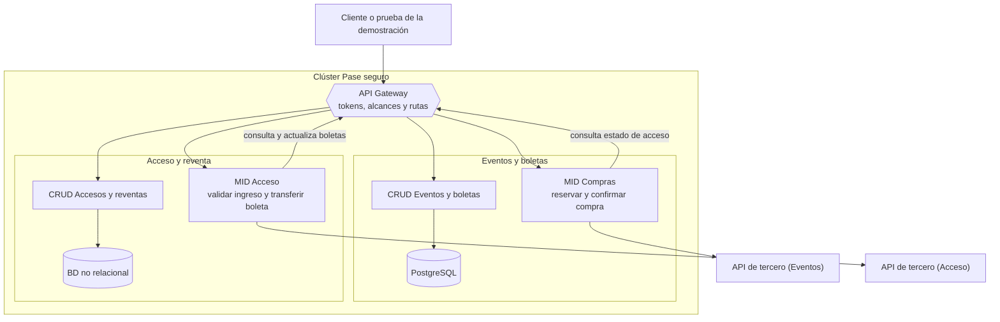

# Clúster Pase seguro: boletería anti-reventa con acceso por QR

Documento de requisitos del clúster. Complementa el enunciado general del proyecto final (arquitectura, seguridad, pipeline, metodología y rúbrica están allá). Aquí está lo específico de su temática: qué construye cada grupo, historias de usuario, criterios de aceptación y cómo va a ser la demostración.

## 1. Qué estamos construyendo

Una plataforma de venta y control de acceso a eventos. El problema que resuelve: la reventa abusiva y la falsificación de boletas. Cada boleta lleva un código QR firmado, solo puede entrar una vez, y si se revende, el precio tiene un tope y los patrones sospechosos se bloquean. Dos grupos, dos servicios:

| Grupo | Servicio | Base de datos |
| --- | --- | --- |
| A | Eventos y boletas | PostgreSQL administrado (opcional: Redis para el bloqueo temporal de boletas) |
| B | Acceso y reventa | **No relacional** (MongoDB o Cosmos DB con API de Mongo) |

(Las letras A y B son solo para este documento.)

**Flujo de la demostración:** una persona reserva una boleta, la paga, entra al evento con su QR y un segundo intento con la misma boleta es rechazado. Además, una boleta se revende dentro del tope y otra reventa abusiva es bloqueada.

Como el clúster solo tiene dos grupos, el reto de integración es más directo: cada uno depende del otro en los dos sentidos.



## 2. Reglas del clúster

- Las dos integraciones esperadas son: Eventos y boletas consulta Acceso y reventa; Acceso y reventa consulta Eventos y boletas.
- Cada grupo entrega un CRUD y un MID (con al menos dos endpoints), contrato OpenAPI de cada API y consumo de un API de tercero (sección 7).
- Los dos grupos usan **lenguaje y framework distintos** entre sí (en un clúster de dos, la regla de diversidad significa que no pueden coincidir).
- El clúster designa un líder del gateway (sección 8).
- Formato de error común, acordado en el repositorio del clúster. Propuesta: `{ "codigo": "boleta_ya_usada", "mensaje": "...", "detalle": {} }`.
- **Una boleta se identifica por su `codigo`** (un UUID). El QR contiene ese código y una firma (sección 4.2). Ambos grupos usan exactamente el mismo formato, así que acuérdenlo el primer día.

## 3. Identidades y alcances (scopes)

| Alcance | Permite | Quién lo usa |
| --- | --- | --- |
| `accesos:leer` | Consultar el estado de acceso de una boleta (si ya entró, si está bloqueada) | MID Compras |
| `boletas:leer` | Consultar boletas y eventos | MID Acceso |
| `boletas:escribir` | Cambiar el propietario o el estado de una boleta | MID Acceso |

Matriz de integraciones:

| # | Consumidor | Proveedor | Endpoint que consume | Alcance |
| --- | --- | --- | --- | --- |
| 1 | MID Compras | Acceso y reventa | `GET /boletas/{codigo}/estado-acceso` | `accesos:leer` |
| 2 | MID Acceso | Eventos y boletas | `GET /boletas/{codigo}`, `GET /eventos/{id}` y `PATCH /boletas/{codigo}/propietario` | `boletas:leer`, `boletas:escribir` |

## 4. Grupo Eventos y boletas

### 4.1 API CRUD: Eventos y boletas (PostgreSQL)

**Tablas mínimas:**

- `eventos` (id, nombre, recinto, fecha_hora, aforo, precio_base, estado `activo` o `cancelado` o `finalizado`).
- `boletas` (codigo UUID, evento_id, estado `disponible` o `reservada` o `vendida` o `usada`, propietario_id, precio_pagado, reservada_hasta).
- `compras` (id, comprador_id, evento_id, boletas, estado `pendiente` o `confirmada` o `vencida`, creada_en).

Semilla: 3 eventos (uno ya finalizado) y 50 boletas por evento activo. Acuerden con Acceso y reventa los códigos de al menos 10 boletas ya `vendida` para sus pruebas.

| Método y ruta | Qué hace | Códigos |
| --- | --- | --- |
| `GET /eventos` | Lista con filtros `estado`, `desde`, `hasta` y paginación | 200 |
| `GET /eventos/{id}` | Detalle con boletas disponibles | 200, 404 |
| `POST /eventos`, `PUT /eventos/{id}` | Crea y edita (al crear se generan las boletas según el aforo) | 201, 200, 400, 404 |
| `DELETE /eventos/{id}` | Cancela el evento (no si hay boletas vendidas) | 204, 404, 409 |
| `GET /boletas` | Lista con filtros `eventoId`, `estado`, `propietarioId` | 200 |
| `GET /boletas/{codigo}` | Detalle | 200, 404 |
| `PATCH /boletas/{codigo}/propietario` | Cambia el propietario y el precio pagado (lo usa Acceso y reventa en una transferencia) | 200, 400, 404, 409 |

**Historias de usuario:**

- **E-HU1.** Como organizador, quiero crear un evento y que se generen sus boletas automáticamente.
  - Un evento de aforo 50 genera 50 boletas `disponible`, con códigos únicos.
  - Fecha en el pasado o aforo menor a 1 responde 400.
- **E-HU2.** Como comprador, quiero ver los eventos y cuántas boletas quedan.
  - El detalle del evento incluye la cantidad de boletas disponibles.
- **E-HU3.** Como servicio de acceso, quiero consultar una boleta por su código para validarla.
  - Un código inexistente responde 404.

### 4.2 API MID: Compras

**Endpoint 1: `POST /compras/reservar`** con `{ "eventoId", "compradorId", "cantidad" }`

Reglas de negocio:

1. Si el evento no existe, 404. Si no está `activo`, 409 `evento_no_disponible`.
2. Máximo 4 boletas por comprador y evento (variable `MAX_BOLETAS`). Más, 409 `limite_excedido`.
3. Si no hay suficientes boletas disponibles, 409 `sin_boletas`.
4. Selecciona las boletas y las **bloquea por 10 minutos** (`reservada_hasta`, variable `MINUTOS_BLOQUEO`). Dos compradores a la vez no pueden bloquear la misma boleta. (Pueden usar bloqueo en la base de datos, o Redis con expiración automática como opcional.)
5. Por cada boleta, consulta a Acceso y reventa su estado de acceso: si está marcada como `bloqueada` o ya `usada`, la descarta y toma otra.
6. Crea la compra `pendiente` y responde 201 con las boletas bloqueadas, el total (`precio_base * cantidad`) y la hora de vencimiento.

**Endpoint 2: `POST /compras/{id}/confirmar`** con `{ "referenciaPago": "..." }`

1. Si la compra no existe, 404. Si ya está confirmada, responde 200 con la misma compra (idempotente).
2. Si pasaron los 10 minutos, la compra pasa a `vencida`, las boletas se liberan y responde 409 `reserva_vencida`.
3. Si está vigente: las boletas pasan a `vendida`, con el comprador como propietario.
4. Genera para cada boleta un **QR firmado**: el contenido es `codigo.firma`, donde `firma` es un HMAC-SHA256 del código con un secreto compartido con Acceso y reventa (variable de entorno `QR_SECRET`, nunca en el repositorio).
5. Responde 200 con las boletas y sus códigos QR.

**Historias de usuario:**

- **E-HU4.** Como comprador, quiero apartar mis boletas unos minutos mientras pago.
  - Dos compradores pidiendo la última boleta a la vez: uno obtiene 201 y el otro 409 `sin_boletas`.
  - Una reserva sin confirmar durante 10 minutos libera las boletas.
- **E-HU5.** Como comprador, quiero recibir boletas con un QR que no se pueda falsificar.
  - El QR cambia si alguien modifica el código (la firma deja de coincidir).
- **E-HU6.** Como organizador, quiero que no se me acaparen boletas.
  - El quinto intento de un mismo comprador responde 409 `limite_excedido`.

## 5. Grupo Acceso y reventa

### 5.1 API CRUD: Accesos y reventas (base no relacional)

**Colecciones mínimas:**

```json
// colección accesos
{
  "id": "acc-001",
  "boletaCodigo": "b7a1...",
  "eventoId": "evt-1",
  "puerta": "A",
  "resultado": "aceptado",
  "motivo": null,
  "registradoEn": "2026-11-21T19:05:00Z"
}

// colección reventas
{
  "id": "rev-001",
  "boletaCodigo": "b7a1...",
  "vendedorId": "usr-3",
  "compradorId": "usr-9",
  "precio": 90000,
  "estado": "completada",
  "marcaSospechosa": false,
  "registradaEn": "2026-11-20T10:00:00Z"
}
```

`resultado`: `aceptado` o `rechazado`. Creen índices por `boletaCodigo` y por `vendedorId`.

| Método y ruta | Qué hace | Códigos |
| --- | --- | --- |
| `GET /accesos` | Lista con filtros `eventoId`, `boletaCodigo`, `resultado` y paginación | 200 |
| `POST /accesos` | Registra un intento de ingreso | 201, 400 |
| `GET /reventas` | Lista con filtros `vendedorId`, `boletaCodigo`, `marcaSospechosa` | 200 |
| `POST /reventas` | Registra una reventa | 201, 400 |
| `PATCH /reventas/{id}` | Cambia estado o marca de sospecha | 200, 400, 404 |
| `GET /boletas/{codigo}/estado-acceso` | Resumen: si ya ingresó, cuántas veces se transfirió, si está bloqueada | 200 |

Para una boleta sin historial, `estado-acceso` responde 200 con `ingreso: false, transferencias: 0, bloqueada: false` (no 404, porque la boleta puede existir en Eventos sin tener movimientos aquí).

**Historias de usuario:**

- **A-HU1.** Como seguridad del evento, quiero un registro de cada intento de ingreso, aceptado o rechazado.
  - Cada intento queda guardado con puerta, hora y motivo del rechazo.
- **A-HU2.** Como servicio de compras, quiero saber el estado de acceso de una boleta antes de venderla.
  - `estado-acceso` refleja un ingreso aceptado previo y las transferencias acumuladas.
- **A-HU3.** Como auditor, quiero consultar las reventas marcadas como sospechosas.

### 5.2 API MID: Validación de ingreso y transferencia

**Endpoint 1: `POST /accesos/validar`** con `{ "codigoQr", "puerta", "eventoId" }`

1. Separa `codigo` y `firma`, y verifica la firma con `QR_SECRET`. Si no coincide, registra un acceso `rechazado` (`qr_invalido`) y responde 400.
2. Consulta la boleta a Eventos y boletas. Si no existe, 404 (`boleta_inexistente`). Si no está `vendida` (por ejemplo, solo reservada), responde 409 `boleta_no_vendida`.
3. Verifica que la boleta sea del evento indicado y que el evento esté `activo` y en su día. Si no, 409 con el motivo.
4. Busca en su propia colección si la boleta ya tiene un acceso `aceptado`. Si es así, registra un rechazo y responde 409 `boleta_ya_usada`, indicando hora y puerta del primer ingreso.
5. Si la boleta está bloqueada por reventa sospechosa, responde 403 `boleta_bloqueada`.
6. Si todo está bien, registra el acceso `aceptado` y responde 200.

**Endpoint 2: `POST /reventas/transferir`** con `{ "boletaCodigo", "vendedorId", "compradorId", "precio" }`

1. Consulta la boleta y el evento a Eventos y boletas. Si no existe, 404. Si el `vendedorId` no es el propietario, 403 `no_es_propietario`. Si ya fue usada para ingresar, 409 `boleta_ya_usada`.
2. **Tope de precio:** el precio no puede superar 110% del `precio_base` del evento (variable `TOPE_REVENTA_PCT`). Si lo supera, 422 `precio_excede_tope`, con el máximo permitido en el detalle.
3. **Patrones sospechosos.** Marca la reventa como sospechosa y bloquea la boleta si ocurre alguna de estas:
   - El vendedor hizo 3 o más reventas en las últimas 24 horas.
   - La boleta ya fue transferida 2 veces.
   - El comprador es el mismo vendedor.
   En ese caso responde 409 `reventa_bloqueada` y registra la reventa con `marcaSospechosa: true`.
4. Si pasa todo, actualiza el propietario en Eventos y boletas (`PATCH .../propietario`), registra la reventa `completada` y responde 201.
5. Si Eventos y boletas falla al actualizar, **no registra la reventa** (o la deja `pendiente`, con 503) para evitar que quede un registro sin cambio real.

**Historias de usuario:**

- **A-HU4.** Como persona en la puerta, quiero que el sistema me diga si una boleta es válida sin tener que pensar.
  - Un QR válido entra una vez. El mismo QR otra vez responde 409 `boleta_ya_usada`.
  - Un QR alterado en un solo carácter responde 400.
- **A-HU5.** Como organizador, quiero que la reventa tenga un precio tope.
  - Una boleta de 80.000 COP no se puede revender a 120.000 (422).
- **A-HU6.** Como organizador, quiero detectar revendedores profesionales.
  - La tercera reventa del mismo vendedor en un día es bloqueada y queda registrada como sospechosa.

## 6. Consumo de un API de tercero (por grupo)

Cada grupo elige y justifica su API, siguiendo la sección 6 del enunciado general. Ideas sobre qué categoría buscar (la elección es suya):

- **Eventos y boletas:** pasarela de pagos en modo de pruebas, o envío de correos transaccionales (para enviar las boletas con su QR).
- **Acceso y reventa:** generación de códigos QR como imagen, o geolocalización y clima del recinto.

Recuerden: tiempo máximo de espera, reintentos limitados, caché, plan de degradación declarado en el OpenAPI y simulación en las pruebas.

## 7. Tareas específicas del líder del gateway

- Definir con los dos grupos los alcances de la sección 3 y emitir las dos credenciales.
- Garantizar el enrutamiento por prefijo (`/eventos`, `/boletas`, `/accesos`, `/reventas`, `/compras`) y que el endpoint de token funciona.
- Mantener la colección de pruebas (Postman o similar) con el flujo de la sección 8.
- Revisar los pull requests de contratos junto con el otro grupo.
- Documentar en `GATEWAY.md` quién es el líder y por qué.

## 8. Guion de la demostración (de punta a punta)

| Paso | Acción | Resultado esperado |
| --- | --- | --- |
| 1 | Llamar sin token | 401 |
| 2 | Con el token del MID Compras, intentar `PATCH /boletas/{codigo}/propietario` | 403 (no tiene `boletas:escribir`) |
| 3 | `POST /compras/reservar` de 2 boletas | 201, boletas `reservada` y hora de vencimiento |
| 4 | `POST /compras/{id}/confirmar` | 200, boletas `vendida` con su QR firmado |
| 5 | `POST /accesos/validar` con ese QR | 200, acceso `aceptado` |
| 6 | Repetir el paso 5 | 409 `boleta_ya_usada` |
| 7 | `POST /accesos/validar` con un QR alterado | 400 |
| 8 | `POST /reventas/transferir` de la segunda boleta al precio base | 201, el propietario cambia |
| 9 | `POST /reventas/transferir` a un precio mayor al tope | 422 |
| 10 | Tres reventas seguidas del mismo vendedor | La tercera, 409 `reventa_bloqueada` |
| 11 | `POST /compras/{id}/confirmar` de una compra vencida | 409 `reserva_vencida` |
| 12 | Consultar un código de boleta inexistente | 404 |
| 13 | Apagar Acceso y reventa y repetir el paso 3 | 503 |

## 9. Qué debe tener el repositorio de cada grupo (lista de verificación)

- [ ] CRUD y MID con contrato OpenAPI (alcances y errores declarados).
- [ ] Datos semilla coherentes entre ambos grupos (mismos códigos de boleta y eventos).
- [ ] Variables de entorno para URLs, credenciales (incluido `QR_SECRET`) y parámetros de negocio, con `.env.example`.
- [ ] `/health` que responde 200.
- [ ] Rechazo de peticiones sin la cabecera secreta del gateway.
- [ ] Pruebas unitarias de las reglas del MID (firma del QR, bloqueo y vencimiento, tope de precio, patrones sospechosos, doble uso).
- [ ] Pipeline por pull request (pruebas al abrirlo, despliegue al fusionar).
- [ ] README con instalación, ejecución, pruebas, ficha del API de tercero, lenguaje y framework, y aportes de cada integrante.

Electiva de Desarrollo Web Backend
