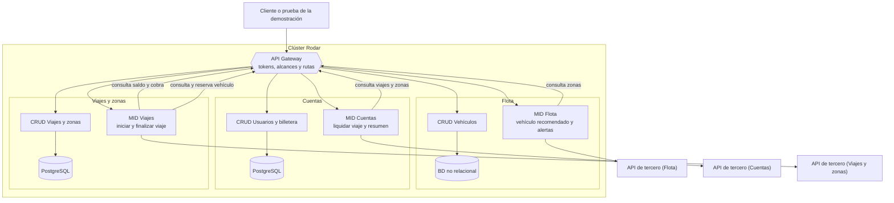

# Clúster Rodar: scooters y bicicletas compartidas

Documento de requisitos del clúster. Complementa el enunciado general del proyecto final (arquitectura, seguridad, pipeline, metodología y rúbrica están allá). Aquí está lo específico de su temática: qué construye cada grupo, historias de usuario, criterios de aceptación y cómo va a ser la demostración.

## 1. Qué estamos construyendo

Una plataforma de micromovilidad: personas que alquilan scooters y bicicletas por minutos. Tres grupos, tres servicios:

| Grupo | Servicio | Base de datos |
| --- | --- | --- |
| A | Flota | **No relacional** (MongoDB o Cosmos DB con API de Mongo), por las consultas geoespaciales |
| B | Cuentas | PostgreSQL administrado |
| C | Viajes y zonas | PostgreSQL administrado |

(Las letras A, B y C son solo para este documento. Cada clúster decide qué grupo hace qué.)

**Flujo de la demostración:** un usuario con saldo pide un vehículo cercano, inicia un viaje, lo finaliza en otro lugar y se le cobra el valor correcto, con recargo si terminó en una zona con recargo.



## 2. Reglas del clúster

- Las cuatro integraciones esperadas son: Flota consulta Viajes y zonas; Cuentas consulta Viajes y zonas; Viajes y zonas consulta Cuentas; Viajes y zonas consulta Flota. La nota del clúster depende de cuántas funcionen en la demostración.
- Cada grupo entrega un CRUD y un MID (con al menos dos endpoints), contrato OpenAPI de cada API y consumo de un API de tercero (ver sección 7 de este documento).
- Al menos un grupo usa un lenguaje y un framework distintos a los de los otros.
- El clúster designa un líder del gateway (sección 8).
- Todas las respuestas de error siguen el mismo formato JSON, acordado en el repositorio del clúster. Propuesta mínima: `{ "codigo": "saldo_insuficiente", "mensaje": "...", "detalle": {} }`.

## 3. Identidades y alcances (scopes)

Cada MID tiene su propio `client_id` en el gateway. Los alcances propuestos (ajústenlos en su contrato):

| Alcance | Permite | Quién lo usa |
| --- | --- | --- |
| `vehiculos:leer` | Consultar vehículos | MID Viajes |
| `vehiculos:escribir` | Cambiar estado y ubicación de un vehículo | MID Viajes |
| `usuarios:leer` | Consultar usuarios y saldo | MID Viajes |
| `billetera:escribir` | Registrar débitos y recargas | MID Cuentas (propio) y MID Viajes (para disparar liquidación) |
| `viajes:leer` | Consultar viajes | MID Cuentas |
| `zonas:leer` | Consultar zonas y verificar un punto | MID Flota, MID Cuentas |

Matriz de integraciones (una fila por integración esperada):

| # | Consumidor | Proveedor | Endpoint que consume | Alcance |
| --- | --- | --- | --- | --- |
| 1 | MID Flota | Viajes y zonas | `GET /zonas/verificar` | `zonas:leer` |
| 2 | MID Cuentas | Viajes y zonas | `GET /viajes/{id}` y `GET /zonas/{id}` | `viajes:leer`, `zonas:leer` |
| 3 | MID Viajes | Cuentas | `GET /usuarios/{id}/billetera` y `POST /liquidaciones` | `usuarios:leer`, `billetera:escribir` |
| 4 | MID Viajes | Flota | `GET /vehiculos/{id}` y `PATCH /vehiculos/{id}/estado` | `vehiculos:leer`, `vehiculos:escribir` |

## 4. Grupo Flota

### 4.1 API CRUD: Vehículos (base no relacional)

**Modelo del documento:**

```json
{
  "id": "veh-0001",
  "tipo": "scooter",
  "bateriaPct": 78,
  "estado": "disponible",
  "ubicacion": { "type": "Point", "coordinates": [-74.0721, 4.7110] },
  "actualizadoEn": "2026-11-20T14:30:00Z"
}
```

`tipo`: `scooter` o `bicicleta`. `estado`: `disponible`, `en_viaje`, `mantenimiento`. Creen un **índice geoespacial** (2dsphere en MongoDB) sobre `ubicacion`.

**Endpoints mínimos:**

| Método y ruta | Qué hace | Códigos |
| --- | --- | --- |
| `GET /vehiculos` | Lista con filtros `tipo`, `estado`, `bateriaMin`, y por cercanía `lat`, `lng`, `radioMetros`; paginación `pagina` y `tamano` | 200, 400 |
| `GET /vehiculos/{id}` | Detalle | 200, 404 |
| `POST /vehiculos` | Crea un vehículo | 201, 400 |
| `PUT /vehiculos/{id}` | Reemplaza un vehículo | 200, 400, 404 |
| `PATCH /vehiculos/{id}/estado` | Cambia el estado y, opcionalmente, la ubicación y la batería | 200, 400, 404, 409 |
| `DELETE /vehiculos/{id}` | Elimina (no permitido si está `en_viaje`) | 204, 404, 409 |

**Historias de usuario y criterios de aceptación:**

- **F-HU1.** Como operador de la flota, quiero registrar y editar vehículos para mantener el inventario al día.
  - Rechaza `bateriaPct` fuera de 0 a 100, `tipo` desconocido o coordenadas inválidas con 400.
  - Al arrancar con la base vacía carga 30 vehículos semilla repartidos en una zona de la ciudad.
- **F-HU2.** Como otro servicio, quiero buscar vehículos cercanos a un punto para ofrecer opciones a un usuario.
  - `GET /vehiculos?lat=4.711&lng=-74.072&radioMetros=500&estado=disponible` devuelve solo los que están dentro del radio, ordenados del más cercano al más lejano.
- **F-HU3.** Como servicio de viajes, quiero cambiar el estado de un vehículo de forma segura para que dos viajes no usen el mismo vehículo.
  - Pasar de `disponible` a `en_viaje` es válido. Pasar de `en_viaje` a `en_viaje` responde 409.
  - La operación es atómica: si dos peticiones llegan a la vez, una sola gana.

### 4.2 API MID: Flota inteligente

**Endpoint 1: `GET /recomendaciones/vehiculo?lat&lng&tipo`**

Reglas de negocio, en orden:

1. Busca vehículos `disponible` en un radio de 500 m (variable de entorno `RADIO_BUSQUEDA_M`).
2. Descarta los de batería menor a 25% (variable `BATERIA_MINIMA`).
3. Por cada candidato, consulta a Viajes y zonas si su ubicación está en una **zona prohibida** y lo descarta si es así.
4. Ordena por una puntuación: `puntaje = distanciaMetros - (bateriaPct * 2)` (menor es mejor). Devuelve los 3 mejores con distancia, batería y puntaje.
5. Si no hay candidatos, responde 200 con lista vacía y un `motivo` (`sin_vehiculos_cercanos` o `todos_en_zona_prohibida`).
6. Si Viajes y zonas no responde, responde 503 (no recomiende vehículos sin validar zonas).

**Endpoint 2: `GET /flota/alertas`**

Devuelve los vehículos que requieren atención del equipo operativo: batería menor a 15%, o ubicados en zona prohibida (consulta a Viajes y zonas), o sin actualizar su ubicación hace más de 2 horas. Cada alerta trae `tipoAlerta` y `prioridad` (alta si batería menor a 10% o en zona prohibida).

**Historias de usuario:**

- **F-HU4.** Como usuario, quiero que me sugieran el mejor vehículo cercano para no caminar de más ni quedarme sin batería.
  - Con los datos semilla acordados con Viajes y zonas, la demostración siempre produce al menos una recomendación.
  - Un vehículo con 20% de batería nunca aparece en las recomendaciones.
- **F-HU5.** Como operador, quiero ver qué vehículos necesito recoger o recargar para priorizar mi ruta.
  - La respuesta está ordenada por prioridad y luego por tiempo sin actualizar.

## 5. Grupo Cuentas

### 5.1 API CRUD: Usuarios y billetera (PostgreSQL)

**Tablas mínimas:** `usuarios` (id, nombre, correo único, estado), `billeteras` (usuario_id, saldo), `movimientos` (id, usuario_id, tipo `recarga` o `debito`, monto, referencia, creado_en). Con migraciones versionadas y datos semilla de 10 usuarios con saldos variados (incluya uno con saldo cero).

| Método y ruta | Qué hace | Códigos |
| --- | --- | --- |
| `GET /usuarios` | Lista con filtros `estado`, `correo` y paginación | 200 |
| `POST /usuarios` | Crea usuario y su billetera en cero | 201, 400, 409 (correo repetido) |
| `GET /usuarios/{id}` | Detalle | 200, 404 |
| `PUT /usuarios/{id}` | Actualiza datos | 200, 400, 404 |
| `DELETE /usuarios/{id}` | Desactiva (borrado lógico) | 204, 404 |
| `GET /usuarios/{id}/billetera` | Saldo actual | 200, 404 |
| `POST /billeteras/{usuarioId}/movimientos` | Registra una recarga o un débito | 201, 400, 404, 409 |
| `GET /billeteras/{usuarioId}/movimientos` | Historial paginado | 200, 404 |

**Historias de usuario:**

- **C-HU1.** Como usuario, quiero recargar mi billetera para poder alquilar vehículos.
  - Una recarga de monto menor o igual a cero responde 400.
- **C-HU2.** Como sistema, quiero que un débito nunca deje el saldo negativo.
  - Un débito mayor al saldo responde 409 con código `saldo_insuficiente`, y el saldo no cambia.
- **C-HU3.** Como sistema, quiero que repetir una misma operación por error no cobre dos veces.
  - El movimiento recibe una `referencia` única. Si llega otro con la misma referencia, devuelve el movimiento original con 200 y no registra uno nuevo.

### 5.2 API MID: Liquidación

**Endpoint 1: `POST /liquidaciones` con `{ "viajeId": "..." }`**

Reglas de negocio:

1. Consulta el viaje a Viajes y zonas. Si no existe responde 404. Si no está `finalizado` responde 409 con `viaje_no_finalizado`.
2. Calcula la tarifa: `desbloqueo (1.000 COP) + minutos * 350 COP` (valores en variables de entorno).
3. Consulta la zona de destino del viaje. Si es de tipo `recargo`, suma 20% a la tarifa.
4. **Promoción:** si es el primer viaje finalizado del usuario (consulta el historial de viajes a Viajes y zonas), aplica 50% de descuento sobre la tarifa sin recargo.
5. Descuenta del saldo con un movimiento de débito (con `referencia = viajeId`, para que reintentar no cobre dos veces).
6. Si el saldo no alcanza, responde 409 `saldo_insuficiente` y deja la liquidación como `pendiente`.
7. Devuelve el desglose: `tarifaBase`, `recargo`, `descuento`, `total`, `saldoRestante`.

**Endpoint 2: `GET /usuarios/{id}/resumen-gasto?mes=2026-11`**

Consulta los viajes del usuario en ese mes a Viajes y zonas y devuelve cantidad de viajes, minutos totales, gasto total (suma de sus débitos) y el viaje más caro. Si el usuario no existe, 404.

**Historias de usuario:**

- **C-HU4.** Como usuario, quiero ver cuánto me cobraron y por qué para confiar en el servicio.
  - La respuesta de liquidación incluye el desglose completo y la suma cuadra con el total.
- **C-HU5.** Como usuario nuevo, quiero un descuento en mi primer viaje.
  - Con un usuario sin viajes previos, el descuento aparece. En su segundo viaje, no.
- **C-HU6.** Como usuario, quiero un resumen de mi gasto mensual.
  - Un mes sin viajes devuelve ceros, no un error.

## 6. Grupo Viajes y zonas

### 6.1 API CRUD: Viajes y zonas (PostgreSQL)

**Tablas mínimas:** `viajes` (id, usuario_id, vehiculo_id, estado `iniciado` o `finalizado` o `cancelado`, inicio_en, fin_en, origen, destino, minutos), `zonas` (id, nombre, tipo `prohibida` o `recargo` o `parqueo`, poligono en GeoJSON).

Siembren al menos 4 zonas: una prohibida, una de recargo y dos de parqueo, cubriendo la misma área donde Flota siembra sus vehículos. **Acuerden estas coordenadas con Flota desde el primer día.**

| Método y ruta | Qué hace | Códigos |
| --- | --- | --- |
| `GET /viajes` | Lista con filtros `usuarioId`, `estado`, `desde`, `hasta` y paginación | 200 |
| `GET /viajes/{id}` | Detalle | 200, 404 |
| `POST /viajes` | Crea un viaje (estado `iniciado`) | 201, 400 |
| `PATCH /viajes/{id}` | Actualiza estado, destino y minutos | 200, 400, 404, 409 |
| `GET /zonas` | Lista de zonas con filtro por `tipo` | 200 |
| `GET /zonas/{id}` | Detalle | 200, 404 |
| `POST /zonas`, `PUT /zonas/{id}`, `DELETE /zonas/{id}` | Gestión de zonas (polígono validado) | 201, 200, 204, 400, 404 |
| `GET /zonas/verificar?lat&lng` | Indica en qué zonas cae un punto: `{ "permitida": false, "zonas": [ ... ] }` | 200, 400 |

**Historias de usuario:**

- **V-HU1.** Como administrador, quiero definir zonas delimitadas en el mapa para controlar dónde se puede dejar un vehículo.
  - Un polígono con menos de 4 puntos o que no cierra responde 400.
- **V-HU2.** Como otro servicio, quiero preguntar si un punto está permitido para tomar decisiones.
  - `GET /zonas/verificar` en un punto dentro de la zona prohibida devuelve `permitida: false` y el nombre de la zona. Fuera de todas las zonas devuelve `permitida: true`.
  - La verificación es una consulta de punto dentro de polígono (con PostGIS o con una librería del lenguaje).
- **V-HU3.** Como usuario, quiero que mi historial de viajes quede guardado.
  - El filtro por `usuarioId` y fechas devuelve solo sus viajes.

### 6.2 API MID: Iniciar y finalizar viajes

**Endpoint 1: `POST /viajes/iniciar` con `{ "usuarioId": "...", "vehiculoId": "..." }`**

1. Consulta el saldo a Cuentas. Si el usuario no existe, 404. Si el saldo es menor a 5.000 COP (variable `SALDO_MINIMO`), responde 409 `saldo_insuficiente`.
2. Consulta el vehículo a Flota. Si no existe, 404. Si no está `disponible` o su batería es menor a 15%, responde 409 con el motivo.
3. Cambia el vehículo a `en_viaje` en Flota (operación atómica).
4. Crea el viaje en estado `iniciado`. Si la creación falla después de haber reservado el vehículo, **libera el vehículo** (compensación) y responde 500.
5. Devuelve el viaje con 201.

**Endpoint 2: `POST /viajes/{id}/finalizar` con `{ "lat": ..., "lng": ... }`**

1. Si el viaje no existe, 404. Si ya está `finalizado`, 409.
2. Calcula los minutos desde `inicio_en`.
3. Verifica la zona del punto final. Si es prohibida, marca `multa: true` y la devuelve en la respuesta (el viaje igual finaliza).
4. Guarda el viaje como `finalizado`.
5. Libera el vehículo en Flota con la nueva ubicación y batería estimada (`bateria - minutos * 0.5`).
6. **Después** de guardar, llama a `POST /liquidaciones` de Cuentas con el `viajeId`. Si Cuentas no responde, el viaje queda `finalizado` con `liquidacion: pendiente` y la respuesta es 200 con una advertencia (no se pierde el viaje por una falla ajena).

**Historias de usuario:**

- **V-HU4.** Como usuario con saldo, quiero iniciar un viaje con el vehículo que elegí.
  - Con saldo cero, la respuesta es 409 y el vehículo sigue `disponible`.
- **V-HU5.** Como usuario, quiero finalizar mi viaje y ver cuánto debo pagar.
  - La respuesta incluye minutos, zona final y el resultado de la liquidación.
- **V-HU6.** Como plataforma, quiero que una falla en Cuentas o en Flota no deje datos inconsistentes.
  - Con Flota apagada, iniciar un viaje responde 503 y no se crea ningún viaje.

## 7. Consumo de un API de tercero (por grupo)

Cada grupo elige y justifica su API, siguiendo las reglas de la sección 6 del enunciado general. Ideas sobre qué categoría buscar según el servicio (la elección es suya):

- **Flota:** clima, para recomendar de otra forma si llueve; o mapas para calcular distancia caminando hasta el vehículo.
- **Cuentas:** conversión de moneda, o una pasarela de pagos en modo de pruebas para las recargas.
- **Viajes y zonas:** geocodificación (convertir un punto en una dirección legible para mostrar origen y destino), o rutas.

Recuerden: tiempo máximo de espera, reintentos limitados, caché, plan de degradación declarado en el OpenAPI y simulación en las pruebas.

## 8. Tareas específicas del líder del gateway

- Definir con los tres grupos los alcances de la sección 3 y emitir las tres credenciales.
- Garantizar que la ruta `/token` funciona y que cada prefijo (`/flota`, `/cuentas`, `/viajes`) enruta al servicio correcto.
- Mantener un archivo de colección de pruebas (Postman o similar) que ejecute el flujo completo de la sección 9.
- Revisar los pull requests de contratos junto con los grupos consumidores.
- Documentar todo esto en `GATEWAY.md` (quién es el líder y por qué).

## 9. Guion de la demostración (de punta a punta)

| Paso | Acción | Resultado esperado |
| --- | --- | --- |
| 1 | Pedir token sin credenciales válidas | 401 |
| 2 | Pedir token con las del MID Flota e intentar llamar `POST /viajes/iniciar` | 403 (sin alcance) |
| 3 | `GET /recomendaciones/vehiculo` cerca de un punto sembrado | 200 con 1 a 3 vehículos, ninguno con batería menor a 25% |
| 4 | `POST /viajes/iniciar` con un usuario con saldo | 201, vehículo pasa a `en_viaje` |
| 5 | `POST /viajes/iniciar` con el mismo vehículo | 409 |
| 6 | `POST /viajes/iniciar` con usuario sin saldo | 409 `saldo_insuficiente` |
| 7 | `POST /viajes/{id}/finalizar` en una zona de recargo | 200, con liquidación que incluye el recargo de 20% |
| 8 | Repetir el paso 7 | 409 (ya finalizado) |
| 9 | `GET /usuarios/{id}/resumen-gasto` | 200, el gasto coincide con el paso 7 |
| 10 | Apagar el servicio de Flota y repetir el paso 3 | 503 |
| 11 | Consultar un viaje inexistente a través de Cuentas | 404 |

## 10. Qué debe tener el repositorio de cada grupo (lista de verificación)

- [ ] CRUD y MID con contrato OpenAPI (alcances y errores declarados).
- [ ] Datos semilla coherentes con los de los otros grupos.
- [ ] Variables de entorno para todas las URLs, credenciales y parámetros de negocio, con `.env.example`.
- [ ] `/health` que responde 200.
- [ ] Rechazo de peticiones sin la cabecera secreta del gateway.
- [ ] Pruebas unitarias de las reglas del MID (tarifa, recargo, descuento, filtros de recomendación, compensaciones).
- [ ] Pipeline por pull request (pruebas al abrirlo, despliegue al fusionar).
- [ ] README con instalación, ejecución, pruebas, ficha del API de tercero, lenguaje y framework, y aportes de cada integrante.

## 11. Versión de 2 grupos

Si en su clúster solo hay dos grupos: **Flota** (igual que arriba) y **Viajes y cuentas**, que une las secciones 5 y 6 en un solo grupo (usuarios, billetera, viajes y zonas, con los dos MID). Integraciones esperadas (2): Flota consulta Viajes y cuentas; Viajes y cuentas consulta Flota.

Electiva de Desarrollo Web Backend
