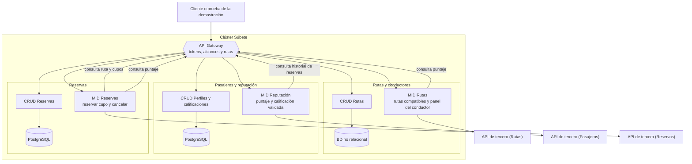

# Clúster Súbete: viajes compartidos en carro entre estudiantes

Documento de requisitos del clúster. Complementa el enunciado general del proyecto final (arquitectura, seguridad, pipeline, metodología y rúbrica están allá). Aquí está lo específico de su temática: qué construye cada grupo, historias de usuario, criterios de aceptación y cómo va a ser la demostración.

## 1. Qué estamos construyendo

Una plataforma para que estudiantes con carro ofrezcan cupos en sus rutas diarias y otros estudiantes los reserven, compartiendo el costo. Su diferencial es la **confianza**: quien tiene mala reputación no puede reservar, y quien tiene buena reputación aparece primero. Tres grupos, tres servicios:

| Grupo | Servicio | Base de datos |
| --- | --- | --- |
| A | Rutas y conductores | **No relacional** (MongoDB o Cosmos DB con API de Mongo): el trazado de la ruta como línea geográfica |
| B | Pasajeros y reputación | PostgreSQL administrado |
| C | Reservas | PostgreSQL administrado |

(Las letras A, B y C son solo para este documento.)

**Flujo de la demostración:** un pasajero busca rutas que pasen cerca de su origen y destino a su hora, reserva un cupo, paga su parte del costo, al final se califican mutuamente y esa calificación cambia su reputación.



## 2. Reglas del clúster

- Las cuatro integraciones esperadas son: Rutas consulta Pasajeros y reputación; Pasajeros y reputación consulta Reservas; Reservas consulta Rutas; Reservas consulta Pasajeros y reputación.
- Cada grupo entrega un CRUD y un MID (con al menos dos endpoints), contrato OpenAPI de cada API y consumo de un API de tercero (sección 7).
- Al menos un grupo usa un lenguaje y un framework distintos a los de los otros.
- El clúster designa un líder del gateway (sección 8).
- Formato de error común, acordado en el repositorio del clúster. Propuesta: `{ "codigo": "sin_cupos", "mensaje": "...", "detalle": {} }`.
- Todos los puntos geográficos se expresan como `[longitud, latitud]` (el orden de GeoJSON). Es el error de integración más frecuente en este tipo de proyectos, así que lo dejamos escrito.

## 3. Identidades y alcances (scopes)

| Alcance | Permite | Quién lo usa |
| --- | --- | --- |
| `rutas:leer` | Consultar rutas | MID Reservas |
| `rutas:escribir` | Descontar o devolver cupos de una ruta | MID Reservas |
| `perfiles:leer` | Consultar perfiles y puntajes | MID Rutas, MID Reservas |
| `reservas:leer` | Consultar reservas de un usuario | MID Reputación |

Matriz de integraciones:

| # | Consumidor | Proveedor | Endpoint que consume | Alcance |
| --- | --- | --- | --- | --- |
| 1 | MID Rutas | Pasajeros y reputación | `GET /perfiles/{id}/puntaje` | `perfiles:leer` |
| 2 | MID Reputación | Reservas | `GET /reservas?usuarioId&estado` y `GET /reservas/{id}` | `reservas:leer` |
| 3 | MID Reservas | Rutas | `GET /rutas/{id}` y `PATCH /rutas/{id}/cupos` | `rutas:leer`, `rutas:escribir` |
| 4 | MID Reservas | Pasajeros y reputación | `GET /perfiles/{id}/puntaje` | `perfiles:leer` |

## 4. Grupo Rutas y conductores

### 4.1 API CRUD: Rutas (base no relacional)

**Modelo del documento:**

```json
{
  "id": "ruta-0001",
  "conductorId": "usr-12",
  "origen": { "nombre": "Chapinero", "punto": { "type": "Point", "coordinates": [-74.0645, 4.6486] } },
  "destino": { "nombre": "Universidad", "punto": { "type": "Point", "coordinates": [-74.0415, 4.7012] } },
  "trazado": { "type": "LineString", "coordinates": [[-74.0645, 4.6486], [-74.0600, 4.6650], [-74.0415, 4.7012]] },
  "salida": "2026-11-21T06:30:00Z",
  "cuposTotales": 3,
  "cuposDisponibles": 3,
  "precioTotal": 12000,
  "estado": "abierta"
}
```

`estado`: `abierta`, `llena`, `cerrada`. Creen un índice geoespacial sobre `trazado`.

| Método y ruta | Qué hace | Códigos |
| --- | --- | --- |
| `GET /rutas` | Lista con filtros `conductorId`, `estado`, `desde`, `hasta` y paginación | 200 |
| `GET /rutas/{id}` | Detalle | 200, 404 |
| `POST /rutas` | Crea una ruta | 201, 400 |
| `PUT /rutas/{id}` | Actualiza la ruta | 200, 400, 404, 409 |
| `DELETE /rutas/{id}` | Cierra o elimina (no si tiene reservas activas) | 204, 404, 409 |
| `PATCH /rutas/{id}/cupos` con `{ "delta": -1 }` | Descuenta o devuelve cupos | 200, 400, 404, 409 (`sin_cupos`) |

**Historias de usuario:**

- **R-HU1.** Como conductor, quiero publicar mi ruta con horario, cupos y precio para ofrecer mi viaje.
  - Rechaza `cuposTotales` menor a 1 o mayor a 6, precio negativo, salida en el pasado y trazados con menos de 2 puntos (400).
  - Se cargan 15 rutas semilla en una zona de la ciudad, acordadas con Reservas.
- **R-HU2.** Como sistema de reservas, quiero descontar un cupo de forma atómica para no vender de más.
  - `PATCH` con `delta: -1` cuando `cuposDisponibles` es 0 responde 409 `sin_cupos`.
  - Si dos peticiones simultáneas piden el último cupo, una responde 200 y la otra 409. Prueben esto con un script.
  - Cuando los cupos llegan a 0, la ruta pasa a `llena`; al devolver un cupo vuelve a `abierta`.
- **R-HU3.** Como conductor, quiero editar o cerrar mi ruta, pero sin dejar a pasajeros colgados.
  - Cerrar una ruta con reservas confirmadas responde 409.

### 4.2 API MID: Búsqueda inteligente de rutas

**Endpoint 1: `GET /rutas/compatibles?origenLat&origenLng&destinoLat&destinoLng&desde&hasta`**

1. Busca rutas `abiertas` con cupos, con salida entre `desde` y `hasta`.
2. El trazado debe pasar a menos de 800 m del origen del pasajero **y** a menos de 800 m de su destino (variable `RADIO_M`).
3. El orden importa: el punto del trazado más cercano al origen debe aparecer **antes** que el cercano al destino (si no, el carro va en sentido contrario).
4. Para cada ruta consulta el puntaje del conductor a Pasajeros y reputación.
5. Calcula `puntaje = (distanciaOrigenM + distanciaDestinoM) / 100 - puntajeConductor * 2` y ordena de menor a mayor.
6. Excluye conductores con insignia `en_observacion`.
7. Devuelve para cada ruta: distancia a pie al origen y destino, puntaje y insignia del conductor.
8. Si no hay resultados, 200 con lista vacía.

**Endpoint 2: `GET /conductores/{id}/panel`**

Devuelve las rutas del conductor con su ocupación (`cupos ocupados / cupos totales`) y, junto con ellas, su puntaje e insignia actuales (consulta a Pasajeros y reputación). Si el conductor no tiene rutas, 200 con lista vacía. Si el perfil no existe, 404.

**Historias de usuario:**

- **R-HU4.** Como pasajero, quiero ver solo las rutas que realmente me sirven, de la mejor a la peor.
  - Una ruta que pasa cerca del destino pero lejos del origen no aparece. Una ruta en sentido contrario tampoco.
- **R-HU5.** Como pasajero, quiero ver primero a los conductores confiables.
  - Con dos rutas igual de cercanas, la del conductor con mejor puntaje va primera.
- **R-HU6.** Como conductor, quiero ver cómo va la ocupación de mis rutas y mi reputación.

## 5. Grupo Pasajeros y reputación

### 5.1 API CRUD: Perfiles y calificaciones (PostgreSQL)

**Tablas mínimas:** `perfiles` (id, nombre, correo único, rol `pasajero` o `conductor` o `ambos`, creado_en), `calificaciones` (id, reserva_id, de_perfil_id, para_perfil_id, estrellas 1 a 5, comentario, creado_en; única por `reserva_id` y `de_perfil_id`). Semilla: 12 perfiles, con calificaciones que dejen al menos un usuario "confiable", uno "nuevo" y uno "en observación".

| Método y ruta | Qué hace | Códigos |
| --- | --- | --- |
| `GET /perfiles` | Lista con filtros por `rol` y paginación | 200 |
| `POST /perfiles` | Crea perfil | 201, 400, 409 |
| `GET /perfiles/{id}` | Detalle | 200, 404 |
| `PUT /perfiles/{id}` | Actualiza | 200, 400, 404 |
| `DELETE /perfiles/{id}` | Desactiva | 204, 404 |
| `GET /calificaciones` | Lista con filtros `paraPerfilId`, `dePerfilId` | 200 |
| `POST /calificaciones` | Crea una calificación | 201, 400, 409 (ya calificó esa reserva) |

**Historias de usuario:**

- **P-HU1.** Como usuario, quiero tener un perfil para participar en la plataforma.
  - Correo repetido responde 409.
- **P-HU2.** Como usuario, quiero calificar a la otra persona de un viaje.
  - Estrellas fuera de 1 a 5 responde 400. Calificar dos veces la misma reserva responde 409.
  - Nadie puede calificarse a sí mismo (400).

### 5.2 API MID: Puntaje de confianza

**Endpoint 1: `GET /perfiles/{id}/puntaje`**

1. Si el perfil no existe, 404.
2. Calcula el **promedio ponderado** de estrellas: las calificaciones de los últimos 30 días pesan el doble que las anteriores.
3. Consulta a Reservas las del usuario y calcula la **tasa de cancelación** (`canceladas / total`) y la cantidad de viajes completados.
4. Calcula `puntaje` de 0 a 5: `promedioPonderado - penalizacionCancelaciones`, con `penalizacionCancelaciones = tasaCancelacion * 2`, limitado entre 0 y 5.
5. Asigna la insignia:
   - `nuevo`: menos de 5 viajes completados (sin importar el puntaje).
   - `confiable`: puntaje de 4.5 o más y tasa de cancelación menor a 10%.
   - `en_observacion`: puntaje menor a 3.5 o tasa de cancelación mayor a 30%.
   - `regular`: el resto.
6. Devuelve `puntaje`, `insignia`, `viajesCompletados`, `tasaCancelacion` y `totalCalificaciones`.
7. Si Reservas no responde, devuelve 503 (no calcular un puntaje incompleto).

**Endpoint 2: `POST /calificaciones/validadas`**

Recibe `{ "reservaId", "deId", "paraId", "estrellas", "comentario" }`. Consulta la reserva a Reservas: debe existir (404 si no), estar `completada` (409 `reserva_no_completada`) y los dos perfiles deben ser quienes participaron en ella (403 `no_participante`). Si todo está bien, crea la calificación.

**Historias de usuario:**

- **P-HU3.** Como pasajero, quiero ver un puntaje claro de cada conductor para decidir con quién viajo.
  - Con los datos semilla, cada tipo de insignia aparece al menos una vez.
- **P-HU4.** Como plataforma, quiero que solo se pueda calificar un viaje real y completado.
  - Calificar una reserva `pendiente` responde 409. Calificar con un perfil ajeno al viaje responde 403.

## 6. Grupo Reservas

### 6.1 API CRUD: Reservas (PostgreSQL)

**Tabla mínima:** `reservas` (id, ruta_id, pasajero_id, cupos, abordaje, descenso, costo, estado `pendiente` o `confirmada` o `cancelada` o `completada`, penalizacion, creado_en, actualizado_en). Semilla: 10 reservas en distintos estados, coherentes con las rutas y perfiles semilla de los otros grupos.

| Método y ruta | Qué hace | Códigos |
| --- | --- | --- |
| `GET /reservas` | Lista con filtros `usuarioId`, `rutaId`, `estado` y paginación | 200 |
| `GET /reservas/{id}` | Detalle | 200, 404 |
| `POST /reservas` | Crea una reserva (estado `pendiente`) | 201, 400 |
| `PATCH /reservas/{id}/estado` | Cambia el estado con transiciones válidas | 200, 400, 404, 409 |
| `DELETE /reservas/{id}` | Elimina solo reservas `pendientes` | 204, 404, 409 |

Transiciones válidas: `pendiente` a `confirmada` o `cancelada`; `confirmada` a `completada` o `cancelada`. Cualquier otra responde 409.

**Historias de usuario:**

- **S-HU1.** Como pasajero, quiero ver mis reservas y su estado.
- **S-HU2.** Como sistema, quiero impedir cambios de estado inválidos.
  - Pasar de `cancelada` a `confirmada` responde 409.

### 6.2 API MID: Reservar y cancelar

**Endpoint 1: `POST /reservas/reservar-cupo`** con `{ "rutaId", "pasajeroId", "cupos", "abordaje", "descenso" }`

Reglas de negocio, en orden:

1. Consulta la ruta a Rutas y conductores. Si no existe, 404. Si no está `abierta`, 409 `ruta_cerrada`.
2. Consulta el puntaje del pasajero a Pasajeros y reputación. Si su insignia es `en_observacion`, responde 403 `usuario_bloqueado`.
3. Valida que el pasajero no tenga ya una reserva activa en esa ruta (409 `reserva_duplicada`).
4. Descuenta el cupo en Rutas con `PATCH .../cupos`. Si responde 409 `sin_cupos`, devuelve 409 `sin_cupos` al cliente. **No crea reserva si no se pudo descontar el cupo.**
5. Calcula el costo del pasajero: `costo = precioTotal * (distanciaDelTramo / distanciaDelTrazadoCompleto) / cuposTotales * cupos`. Si no tienen forma de calcular la distancia exacta del tramo, acuerden con Rutas una aproximación (por ejemplo, la proporción de puntos del trazado) y escríbanla en el contrato.
6. Crea la reserva `confirmada` con ese costo. Si falla el guardado, **devuelve el cupo** a Rutas (compensación).
7. Responde 201 con la reserva y el desglose del costo.

**Endpoint 2: `POST /reservas/{id}/cancelar`**

1. Si la reserva no existe, 404. Si ya está `cancelada` o `completada`, 409.
2. Consulta la ruta a Rutas y conductores para conocer la hora de salida.
3. Si faltan menos de 60 minutos para la salida (`CANCELACION_TARDIA_MIN`), es una **cancelación tardía**: registra una `penalizacion` del 50% del costo.
4. Cambia el estado a `cancelada` y devuelve el cupo a la ruta (`delta: +1`).
5. Responde con el estado, la penalización y el cupo liberado.

**Historias de usuario:**

- **S-HU3.** Como pasajero, quiero reservar un cupo y saber cuánto pagaré.
  - La respuesta incluye el costo calculado y se puede reproducir a mano con los datos de la ruta.
- **S-HU4.** Como conductor, quiero que nunca se reserven más cupos de los que ofrecí.
  - Dos reservas simultáneas por el último cupo: una da 201 y la otra 409. Prueben esto con un script, es parte de la demostración.
- **S-HU5.** Como plataforma, quiero bloquear a usuarios con mala reputación.
  - Con un usuario `en_observacion` de la semilla, reservar responde 403.
- **S-HU6.** Como conductor, quiero que las cancelaciones de última hora tengan consecuencias.
  - Cancelar con 30 minutos de anticipación registra penalización. Cancelar con 5 horas, no.

## 7. Consumo de un API de tercero (por grupo)

Cada grupo elige y justifica su API, siguiendo la sección 6 del enunciado general. Ideas sobre qué categoría buscar (la elección es suya):

- **Rutas y conductores:** rutas y mapas (para generar o validar el trazado entre dos puntos), o geocodificación (convertir una dirección en coordenadas).
- **Pasajeros y reputación:** validación de correo o de datos, o análisis de texto de los comentarios.
- **Reservas:** clima (para advertir de lluvia en la hora de salida), o pasarela de pagos en modo de pruebas.

Recuerden: tiempo máximo de espera, reintentos limitados, caché, plan de degradación declarado en el OpenAPI y simulación en las pruebas.

## 8. Tareas específicas del líder del gateway

- Definir con los tres grupos los alcances de la sección 3 y emitir las tres credenciales.
- Garantizar el enrutamiento por prefijo (`/rutas`, `/perfiles`, `/reservas`) y que el endpoint de token funciona.
- Mantener la colección de pruebas (Postman o similar) con el flujo de la sección 9.
- Revisar los pull requests de contratos junto con los grupos consumidores.
- Documentar en `GATEWAY.md` quién es el líder y por qué.

## 9. Guion de la demostración (de punta a punta)

| Paso | Acción | Resultado esperado |
| --- | --- | --- |
| 1 | Llamar sin token | 401 |
| 2 | Con el token del MID Rutas, intentar `PATCH /rutas/{id}/cupos` | 403 (no tiene `rutas:escribir`) |
| 3 | `GET /rutas/compatibles` con origen y destino de la semilla | 200, rutas ordenadas, ninguna con conductor `en_observacion` |
| 4 | `GET /perfiles/{id}/puntaje` de un conductor | 200 con insignia y tasa de cancelación |
| 5 | `POST /reservas/reservar-cupo` en una ruta con cupos | 201, cupos de la ruta bajan en 1, costo calculado |
| 6 | Reservar la misma ruta con el mismo pasajero | 409 `reserva_duplicada` |
| 7 | Reservar con un pasajero `en_observacion` | 403 |
| 8 | Dos reservas simultáneas por el último cupo | Una 201 y una 409 |
| 9 | Reservar una ruta inexistente | 404 |
| 10 | Cancelar con menos de 60 minutos de la salida | 200 con penalización, cupo devuelto |
| 11 | Completar la reserva y `POST /calificaciones/validadas` | 201 |
| 12 | Repetir el paso 4 | El puntaje cambió |
| 13 | Apagar Pasajeros y reputación y repetir el paso 3 | 503 |

## 10. Qué debe tener el repositorio de cada grupo (lista de verificación)

- [ ] CRUD y MID con contrato OpenAPI (alcances y errores declarados).
- [ ] Datos semilla coherentes con los de los otros grupos (mismos ids de rutas y perfiles).
- [ ] Variables de entorno para URLs, credenciales y parámetros de negocio, con `.env.example`.
- [ ] `/health` que responde 200.
- [ ] Rechazo de peticiones sin la cabecera secreta del gateway.
- [ ] Pruebas unitarias de las reglas del MID (compatibilidad de rutas, puntaje e insignias, cálculo del costo, cancelación tardía, compensaciones).
- [ ] Pipeline por pull request (pruebas al abrirlo, despliegue al fusionar).
- [ ] README con instalación, ejecución, pruebas, ficha del API de tercero, lenguaje y framework, y aportes de cada integrante.

## 11. Versión de 2 grupos

Si en su clúster solo hay dos grupos: **Rutas y conductores** (igual que arriba) y **Reservas y reputación**, que une las secciones 5 y 6 (perfiles, calificaciones y reservas, con los dos MID). Integraciones esperadas (2): Rutas consulta Reservas y reputación; Reservas y reputación consulta Rutas.

Electiva de Desarrollo Web Backend
