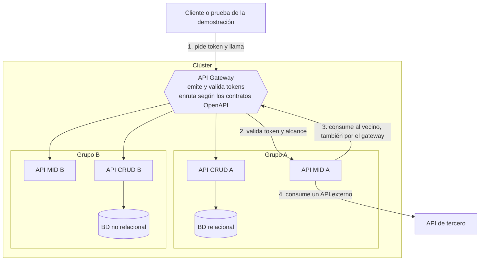
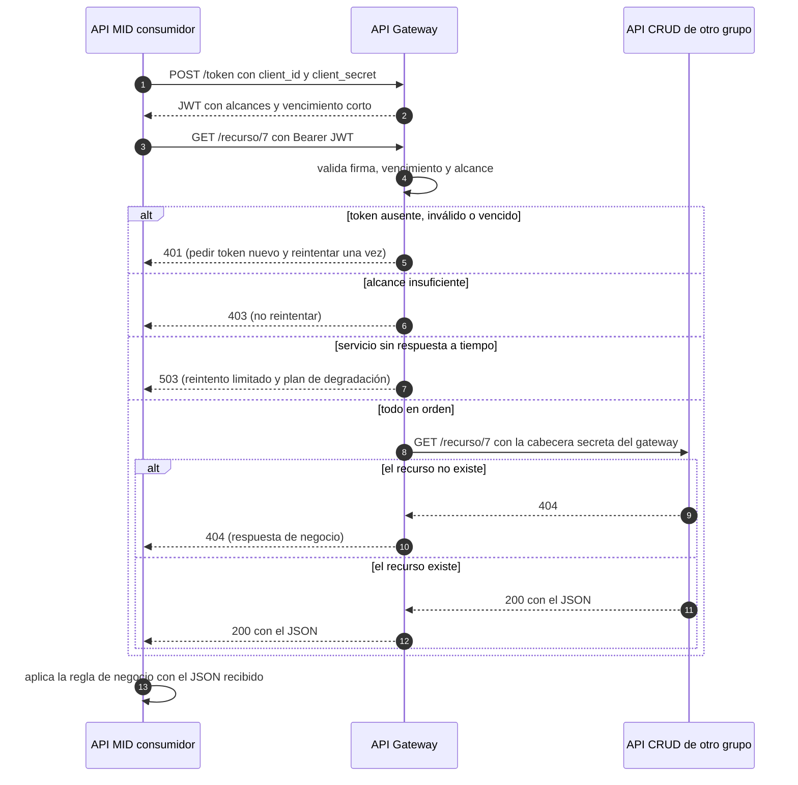

# Proyecto final: ecosistema de microservicios con gateway, seguridad y despliegue automatizado

## 1. De qué se trata

Vamos a emular lo que pasa en un equipo de software real: un producto grande se construye con varios servicios pequeños, cada uno a cargo de un equipo distinto, y esos servicios tienen que hablarse entre sí de forma segura. Ustedes ya practicaron los pasos por separado (APIs REST, contenedores, pipeline en GitHub Actions, despliegue en la nube, bases de datos). Ahora el reto es **integrar**, que en la práctica es lo más difícil.

Trabajaremos en **clústeres de 2 o 3 grupos**. Cada clúster es un mini producto con su propia temática. Dentro del clúster, cada grupo es dueño de sus servicios y consume los de sus compañeros a través de un **gateway** (la puerta de entrada única a los servicios) que el propio clúster construye o configura.

El **tiempo estimado es de 2 semanas**. Pueden y deben usar IA para programar, pero cada integrante tiene que poder explicar y modificar en vivo lo que entregó. La sustentación individual está en la rúbrica.

## 2. Qué entrega cada grupo

Cada grupo desarrolla **al menos dos APIs**:

- **API CRUD** (crear, leer, actualizar y borrar): administra una entidad propia, con base de datos propia, validaciones, filtros, paginación y datos semilla para poder consultarla desde el primer día.
- **API MID** (intermedia): no es dueña de datos básicos. Aplica **reglas de negocio** combinando llamadas a otras APIs. Debe tener al menos dos endpoints y consumir como mínimo dos APIs CRUD, de las cuales al menos una sea de otro grupo (la otra puede ser la propia).

Además, el grupo debe:

- **Consumir al menos un API de tercero** (de una empresa u organización externa al curso). Ustedes la investigan, la eligen y justifican la elección (ver sección 6).
- Escribir un **contrato OpenAPI** por cada API.
- Tener un **repositorio propio** con su pipeline (sección 9).
- Trabajar con la metodología y las reglas de equipo de la sección 8.

## 3. Qué entrega cada clúster

- Un **gateway** que emite y valida tokens, enruta según los contratos y devuelve los errores correctos. La herramienta es libre: un servicio administrado, un gateway de código abierto configurado por ustedes, o uno propio. En clase veremos cómo se monta uno funcional paso a paso. Su gestión está a cargo de un **líder del gateway** (sección 4.1).
- Un **repositorio del clúster** con todos los contratos OpenAPI, la configuración del gateway y la documentación del líder.
- Un **diagrama de la arquitectura** de su aplicación (sección 4.2).
- Al menos **una base de datos no relacional** (por ejemplo, MongoDB o Cosmos DB con API de Mongo) en alguno de los servicios del clúster. El resto puede usar PostgreSQL administrado.
- **Diversidad tecnológica:** en cada clúster, **al menos un grupo debe usar un lenguaje y un framework distintos** a los de los demás (por ejemplo, dos grupos con Node y Express y uno con Python y FastAPI; o uno con Java y Spring Boot). Cambiar solo el framework dentro del mismo lenguaje, o solo el lenguaje, no cumple la regla: deben diferir ambos. Esto nos recuerda que un contrato OpenAPI sirve justamente para que los equipos integren sin importar con qué construyó cada uno.
- El **flujo completo** de la temática funcionando de punta a punta a través del gateway.

## 4. Reglas de arquitectura

**Contrato primero.** Antes de programar, el clúster acuerda los contratos OpenAPI (el archivo que describe qué rutas tiene cada API, qué recibe, qué devuelve, qué errores puede dar y qué permiso exige cada operación). Los contratos viven en el repositorio del clúster, y los cambios se hacen por pull request aprobado por los grupos que consumen esa API. El gateway se configura a partir de esos contratos.

**Todo pasa por el gateway.** Ningún servicio llama a otro directamente. Cada servicio debe rechazar las peticiones que no traigan la cabecera secreta que agrega el gateway, para que nadie lo use saltándose la seguridad.

**Seguridad con tokens (Client Credentials).** Un servicio que quiere consumir a otro pide un token al gateway con su `client_id` y su `client_secret`, y recibe un JWT de corta duración con sus **alcances** (scopes), por ejemplo `flota:leer` o `flota:escribir`. El gateway valida la firma, el vencimiento y el alcance antes de reenviar la petición. Los secretos van en variables seguras (GitHub Secrets y las variables seguras de la plataforma donde despleguen), nunca en el repositorio.

**Las URLs van en variables de entorno.** Ningún servicio lleva escrita la dirección de otro.

**Códigos de respuesta y qué debe hacer el consumidor:**

| Respuesta | Quién la produce | Qué significa | Qué debe hacer el consumidor |
| --- | --- | --- | --- |
| 401 | Gateway | Token ausente, inválido o vencido | Pedir un token nuevo y reintentar una sola vez; si sigue fallando, registrar el error de credenciales |
| 403 | Gateway | Token válido, pero sin permiso para esa ruta o acción | No reintentar: es un problema de permisos |
| 404 | Servicio dueño del dato | El recurso no existe | Es una respuesta de negocio: informar a su propio cliente |
| 503 | Gateway o el propio consumidor | El servicio no respondió a tiempo o está caído | Reintentar con límite y tiempo máximo de espera; si no responde, devolver un 503 a su propio cliente |

### 4.1 Líder del gateway

El gateway es la pieza que une a todos, y si nadie responde por él se vuelve el cuello de botella del clúster. Por eso cada clúster **designa a una persona como líder del gateway** (de cualquier grupo del clúster). El líder:

- Coordina la configuración del gateway, la emisión de credenciales (`client_id` y `client_secret`) de cada servicio y la forma de los alcances.
- Revisa y aprueba los pull requests del repositorio del clúster que modifican la configuración del gateway o los contratos, junto con los consumidores afectados.
- Es el punto de contacto cuando una integración falla entre grupos.

El liderazgo **no significa que haga todo el trabajo**: las tareas del gateway se reparten en el tablero y se entregan por pull request como las demás.

**Debe quedar sustentado y documentado.** En el repositorio del clúster, un archivo `GATEWAY.md` con: quién es el líder y por qué se eligió (experiencia, disponibilidad, acuerdo del clúster, la razón que sea, pero explicada), qué responsabilidades asume, cómo se toman las decisiones sobre el gateway y qué pasa si el líder no está disponible (quién lo reemplaza). El líder y el clúster defienden esta decisión en la sustentación.

### 4.2 Diagrama de la arquitectura y flujo de comunicación

Este es el flujo que esperamos ver, ya sea que su clúster tenga 2 o 3 grupos:

Y así debe comportarse cada consumo entre servicios, con los errores que ya definimos:

**Lo que deben entregar:** un diagrama de la arquitectura de **su** aplicación (no una copia de este), guardado en el repositorio del clúster y enlazado desde el README. Puede hacerse en Mermaid (se visualiza directamente en GitHub), draw.io o una herramienta equivalente, y debe mostrar al menos: el gateway, cada servicio (CRUD y MID) con su grupo, las bases de datos y su tipo, el API de tercero, dónde se despliega cada pieza y cómo fluye una petición completa de la temática elegida.

**Ejemplos para inspirarse** (arquitecturas de referencia de Azure con aplicaciones parecidas a la nuestra):

- [Microservicios con Azure Container Apps](https://learn.microsoft.com/azure/architecture/example-scenario/serverless/microservices-with-container-apps): varios servicios, cada uno con su propia base de datos, y un único punto de entrada externo.
- [Aplicación web básica en Azure App Service](https://learn.microsoft.com/en-us/azure/architecture/web-apps/app-service/architectures/basic-web-app): despliegue sencillo en App Service con base de datos administrada y monitoreo.
- [Protección de APIs con un gateway](https://learn.microsoft.com/azure/architecture/reference-architectures/apis/protect-apis): el lugar del gateway (Azure API Management) frente a los servicios.
- [Microservicios en AKS](https://learn.microsoft.com/azure/architecture/reference-architectures/containers/aks-microservices/aks-microservices): referencia más avanzada, para quien quiera ver cómo escala.

No tienen que usar esos servicios de Azure. Lo que nos interesa es que su diagrama sea claro y corresponda a lo que realmente desplegaron.

## 5. Bases de datos

- **PostgreSQL administrado:** un servidor compartido con una base de datos y un usuario por grupo. Cada grupo es dueño de su esquema y de sus migraciones. **Ningún servicio lee la base de datos de otro:** si necesita ese dato, lo pide a su API.
- **Base no relacional:** al menos una por clúster. Revisen el costo contra su crédito de estudiante y la persistencia de la opción que elijan (un contenedor sin volumen pierde sus datos al reiniciarse; un servicio administrado como Cosmos DB o MongoDB Atlas evita ese problema).

## 6. Consumo de un API de tercero

Cada grupo debe consumir al menos un API de un tercero desde su MID. No les asignamos cuál: investiguen, comparen y elijan la que tenga sentido para su servicio.

Reglas:

1. La URL y las credenciales (si las hay) van en variables de entorno o secretos.
2. Definan un tiempo máximo de espera, reintentos limitados y caché para respetar los límites del proveedor.
3. Tengan un **plan de degradación**: si el tercero falla, el MID responde un 503 claro o un valor por defecto marcado como tal, y eso queda declarado en el OpenAPI.
4. Los errores del tercero se traducen al contrato propio, sin filtrar llaves ni mensajes internos.
5. Respeten los términos del proveedor (atribución, identificación de la aplicación y límites de uso).
6. En las pruebas automáticas el tercero se simula (mock), para que no dependan de internet.

**Ficha del API de tercero (en el README del grupo):** nombre y enlace a su documentación, qué hace y por qué la eligieron, límites y condiciones de uso, costo, cómo se autentica y qué pasa en su servicio si el tercero falla. Regístrenla en los primeros días para descubrir a tiempo cualquier límite o costo.

## 7. Temáticas

Cada clúster elige una temática distinta, y se ajusta a las reglas de lenguaje y framework de la sección 3. Los clústeres de 3 grupos usan una de las tres primeras; el de 2 grupos usa **Pase seguro**, o la versión de 2 servicios de **Rodar** o de **Súbete**.

### 7.1 Rodar: scooters y bicicletas compartidas (3 grupos)

Flujo de la demostración: un usuario con saldo recibe una recomendación de vehículo, inicia un viaje, lo finaliza y se le liquida y descuenta el valor.

| Grupo / servicio | API CRUD (datos propios) | API MID (lógica que consume a otros) |
| --- | --- | --- |
| Flota | Vehículos (**no relacional**: ubicación y batería, con consultas geoespaciales) | "Vehículo recomendado": el más cercano, con batería suficiente y fuera de zonas prohibidas (consulta Viajes y zonas) |
| Cuentas | Usuarios y billetera | "Liquidar viaje": tarifa por tiempo, recargo por zona y promociones, con débito del saldo (consulta Viajes y zonas) |
| Viajes y zonas | Viajes y geocercas (zonas delimitadas en el mapa) | "Iniciar y finalizar viaje": valida usuario con saldo, reserva vehículo y dispara la liquidación (consulta Cuentas y Flota) |

Integraciones esperadas (4): Flota consulta Viajes y zonas; Cuentas consulta Viajes y zonas; Viajes y zonas consulta Cuentas; Viajes y zonas consulta Flota.

Versión de 2 grupos: **Flota** y **Viajes y cuentas** (la billetera se une a Viajes). Integraciones esperadas (2): Flota consulta Viajes y cuentas; Viajes y cuentas consulta Flota.

### 7.2 Súbete: viajes compartidos en carro entre estudiantes (3 grupos)

Flujo de la demostración: un pasajero encuentra una ruta compatible con su origen, destino y hora, reserva un cupo y se calcula su parte del costo.

| Grupo / servicio | API CRUD (datos propios) | API MID (lógica que consume a otros) |
| --- | --- | --- |
| Rutas y conductores | Rutas ofrecidas con horario y cupos (**no relacional**: el trazado como línea geográfica con índice geoespacial) | "Rutas compatibles": rutas que pasan cerca del origen y destino del pasajero dentro de una ventana de tiempo, ordenadas por cercanía y reputación del conductor (consulta Pasajeros y reputación) |
| Pasajeros y reputación | Perfiles y calificaciones | "Puntaje de confianza": combina calificaciones, cancelaciones y viajes completados en un puntaje e insignia (consulta Reservas) |
| Reservas | Reservas de cupo | "Reservar cupo": verifica ruta y cupo (consulta Rutas y conductores), evita el sobrecupo por concurrencia (conflicto 409), divide el costo por tramo, penaliza la cancelación tardía y bloquea a usuarios con mala reputación (consulta Pasajeros y reputación) |

Integraciones esperadas (4): Rutas consulta Pasajeros y reputación; Pasajeros y reputación consulta Reservas; Reservas consulta Rutas; Reservas consulta Pasajeros y reputación.

Versión de 2 grupos: **Rutas y conductores** y **Reservas y reputación** (las calificaciones se unen a Reservas). Integraciones esperadas (2): Rutas consulta Reservas y reputación; Reservas y reputación consulta Rutas.

### 7.3 Sol compartido: mercado de energía solar entre vecinos (3 grupos)

Flujo de la demostración: un hogar con excedente de energía se empareja con una demanda y se liquida la transacción.

| Grupo / servicio | API CRUD (datos propios) | API MID (lógica que consume a otros) |
| --- | --- | --- |
| Medidores | Hogares y medidores | "Balance del hogar": generación menos consumo del periodo (consulta Telemetría) |
| Telemetría | Lecturas de sensores simulados (**no relacional**: series de tiempo) | "Detector de anomalías": picos y fallas frente al perfil del medidor (consulta Medidores) |
| Mercado | Ofertas y transacciones | "Emparejamiento": cruza excedentes con demandas, aplica precio tope y liquida (consulta Medidores y Telemetría) |

Integraciones esperadas (4): Medidores consulta Telemetría; Telemetría consulta Medidores; Mercado consulta Medidores; Mercado consulta Telemetría.

### 7.4 Pase seguro: boletería anti-reventa con acceso por QR (2 grupos)

Flujo de la demostración: una persona reserva una boleta, la paga, ingresa al evento, y un segundo intento de ingreso con la misma boleta es rechazado.

| Grupo / servicio | API CRUD (datos propios) | API MID (lógica que consume a otros) |
| --- | --- | --- |
| Eventos y boletas | Eventos y boletas | "Reserva temporal": bloquea boletas unos minutos (opcional, con una base clave-valor con expiración automática, como Redis) y confirma la compra; rechaza las ya usadas (consulta Acceso y reventa) |
| Acceso y reventa | Registros de ingreso (**no relacional**) | "Transferencia y validación": valida la boleta, impide el doble uso, limita el precio de reventa y marca patrones sospechosos (consulta Eventos y boletas) |

Integraciones esperadas (2): Eventos y boletas consulta Acceso y reventa; Acceso y reventa consulta Eventos y boletas.

## 8. Metodología y trabajo en equipo

**Marco de trabajo: Scrumban.** Combinamos la cadencia de Scrum con el tablero de Kanban. En la práctica:

- Un **tablero** (GitHub Projects u otro) con columnas mínimas: Por hacer, En progreso, En revisión y Hecho. Cada tarea es un issue, y cada pull request enlaza el issue que resuelve.
- **Límite de trabajo en progreso** por columna (por ejemplo, máximo dos tareas por persona en "En progreso"), para evitar que todo quede a medias.
- **Reunión corta de sincronización** (de pie, 10 a 15 minutos) varias veces por semana, y una **revisión y retrospectiva** al cierre de cada semana, con lo que salió bien, lo que no y qué cambian. Se documentan en el repositorio (una nota breve por reunión es suficiente).
- Los grupos que dependen entre sí también acuerdan en el tablero del clúster las tareas que los cruzan (contratos, credenciales, configuración del gateway).

**Evidencia de trabajo en equipo en los repositorios.** Vamos a revisar el historial, y debe verse que todos aportaron:

- Cada integrante tiene commits y **pull requests propios**, y también **revisa** los de sus compañeros (comentarios y aprobaciones).
- La rama `main` está **protegida**: nadie hace push directo. Todo cambio entra por pull request con al menos una aprobación de otra persona.
- Las ramas y los commits tienen nombres claros y se relacionan con los issues del tablero.

**Todo el flujo de GitHub Actions se dispara por pull request, no por push.** Las pruebas, el linter y la construcción de la imagen corren cuando se abre o actualiza un pull request, y el despliegue se ejecuta cuando ese pull request se **aprueba y se fusiona** a `main` (evento `pull_request` cerrado con fusión). Ningún workflow debe usar el evento `push`.

## 9. Despliegue y pipeline

**Plataforma abierta.** Elijan dónde desplegar: Azure App Service (con contenedor o con código), Azure Container Apps, Azure Container Instances (ACI) o un equivalente. Lo importante es que cada servicio tenga una **URL estable y accesible** para el gateway, que las variables de entorno y los secretos se configuren en la plataforma y que el despliegue lo haga el pipeline, no ustedes a mano. Si usan contenedores, publiquen la imagen en un registro (por ejemplo, Azure Container Registry). Justifiquen su elección en el README.

**Repositorio por grupo** (código de sus APIs). El pipeline funciona así:

1. **Al abrir o actualizar un pull request:** corre las pruebas, el linter de OpenAPI y la construcción de la imagen. Si algo falla, el pull request no se puede fusionar.
2. **Al fusionar el pull request a `main`:** publica la imagen, despliega en la plataforma elegida con sus variables y secretos, y ejecuta una prueba de humo (una verificación rápida de que `/health` responde 200). Si falla, queda registrado y se corrige por un nuevo pull request.

**Repositorio por clúster:** contratos OpenAPI y configuración del gateway, con su propio pipeline por pull request: valida los contratos al abrirlo y redespliega el gateway cuando se fusiona.

**Contenedores o aplicaciones:** lo ideal es un servicio desplegado por API (CRUD y MID por separado). Si el tiempo aprieta, se permite un solo despliegue con ambas APIs como módulos separados, cada una con su propio OpenAPI y su propia ruta en el gateway.

**Direcciones estables:** usen el nombre DNS o la URL que entrega la plataforma, no una IP, porque la IP puede cambiar al reiniciar.

**Cuiden su crédito de estudiante:** usen los niveles más pequeños, y al terminar la demostración borren los recursos que no necesiten.

## 10. Pruebas

**Mínimo obligatorio**

- Pruebas unitarias de las reglas del MID y del CRUD, corriendo en el pipeline.
- Prueba de humo después del despliegue.
- Validación del OpenAPI con un linter.

**Retos opcionales (suman como bonus)**

1. Pruebas de contrato: verificar que el servicio responde lo que su OpenAPI promete (por ejemplo, con Schemathesis o Newman).
2. MID probado contra servicios simulados de los vecinos, incluyendo los casos 401, 403, 404 y 503.
3. Calidad del código: escaneo de secretos, revisión de dependencias, umbral de cobertura o análisis estático.
4. En el repositorio del clúster, detectar automáticamente cambios en un contrato que rompan a un consumidor.

## 11. Entregables finales

- Repositorio de cada grupo, con README: descripción de sus APIs, lenguaje y framework usados, instalación de dependencias (con una línea sobre qué hace cada una), variables de entorno, cómo ejecutar, cómo probar, la ficha del API de tercero y una tabla con lo que aportó cada integrante. El historial debe evidenciar pull requests y revisiones de todos.
- Tabla en el repositorio del clúster con el lenguaje y el framework de cada grupo, que evidencie la regla de diversidad.
- Repositorio del clúster con contratos, configuración del gateway, `GATEWAY.md` (líder y su justificación) y el **diagrama de la arquitectura** de la aplicación.
- Evidencia de Scrumban: el tablero (enlace o capturas) y las notas de las revisiones y retrospectivas.
- URL del gateway y servicios desplegados.
- Demostración en vivo del flujo completo, y un video corto de respaldo por si falla la conexión ese día.

## 12. Evaluación

La nota final tiene dos partes: **30% depende del clúster** (la misma nota para todos sus integrantes) y **70% depende del grupo**. Cada criterio se califica de 0.0 a 5.0 y se multiplica por su peso.

### Parte del clúster (30%)

| Criterio | Peso | Excelente (4.5 a 5.0) | Bueno (3.5 a 4.4) | Aceptable (3.0 a 3.4) | Insuficiente (0.0 a 2.9) |
| --- | --- | --- | --- | --- | --- |
| Integraciones funcionando | 15% | Al menos el 90% de las integraciones esperadas funcionan en la demostración, a través del gateway y con tokens | Entre el 70% y el 89% | Entre el 50% y el 69% | Menos del 50% |
| Gateway, seguridad y liderazgo | 8% | Emite y valida tokens con alcances, enruta según el contrato, devuelve 401, 403 y 503 correctos y los servicios rechazan llamadas directas; el líder está designado, documentado en `GATEWAY.md` y justificado en la sustentación | Tokens y rutas funcionan, pero falta alguno de los errores o el rechazo de llamadas directas, o la documentación del líder está incompleta | Enruta y valida el token, pero sin alcances | Sin validación de tokens o sin gateway |
| Contratos OpenAPI y arquitectura del clúster | 7% | Contratos de todos los servicios validados con linter, con seguridad por operación y errores declarados, cambios por pull request aprobados por los consumidores, y diagrama de arquitectura claro que corresponde a lo desplegado | Contratos completos con detalles menores pendientes | Contratos incompletos o desactualizados respecto al código | Contratos ausentes o que no corresponden a los servicios |

El porcentaje de integraciones se calcula sobre la lista de "integraciones esperadas" de la temática (secciones 7.1 a 7.4). Dentro de cada nivel, la nota exacta sigue esa proporción. Si el clúster no cumple la regla de diversidad de lenguaje y framework (sección 3), la nota máxima del criterio "Contratos OpenAPI y arquitectura del clúster" es 3.0.

### Parte del grupo (70%)

| Criterio | Peso | Excelente (4.5 a 5.0) | Bueno (3.5 a 4.4) | Aceptable (3.0 a 3.4) | Insuficiente (0.0 a 2.9) |
| --- | --- | --- | --- | --- | --- |
| API CRUD | 7% | Operaciones completas, validaciones, filtros, paginación, errores consistentes, datos semilla y migraciones | Completa, con detalles menores pendientes | Funciona, pero faltan validaciones o filtros | Operaciones incompletas o sin base de datos propia |
| API MID | 15% | Al menos dos endpoints con reglas de negocio claras y no triviales, que consumen al menos dos CRUD (uno de otro grupo), y el grupo explica y justifica las reglas | Reglas correctas pero simples, o una dependencia débil | Funciona, pero es casi un CRUD con una llamada adicional | No aplica reglas o no consume otros servicios |
| Consumo de vecinos con tokens y manejo de errores | 9% | Obtiene y renueva tokens, y maneja 401 (renueva y reintenta una vez), 403, 404 y 503 con tiempos máximos y reintentos limitados | Maneja la mayoría de los casos | Solo el caso exitoso y algún error | Sin tokens o sin manejo de errores |
| Consumo del API de tercero | 7% | Elección investigada y justificada, ficha completa en el README, caché, tiempo máximo, plan de degradación declarado en el OpenAPI y simulación en las pruebas | Consumo robusto, con ficha o plan de degradación incompletos | Consume el API sin protección ante fallas | No consume un API de tercero o no justifica su elección |
| Pipeline y despliegue | 9% | Todo por pull request: pruebas, linter y construcción al abrirlo; despliegue y prueba de humo al fusionar; ningún workflow por `push`; sin secretos en el código y con URLs en variables de entorno | Despliegue automático con un paso manual, o algún workflow aún por `push` | Construye la imagen, pero el despliegue es manual | Sin pipeline o con secretos en el repositorio |
| Pruebas | 5% | Pruebas unitarias del MID y del CRUD que corren en el pipeline y lo detienen si fallan | Pruebas en el pipeline con cobertura parcial | Pocas pruebas o solo locales | Sin pruebas |
| Sustentación individual | 12% | Cada integrante explica y modifica en vivo lo que entregó, y responde con seguridad incluso fuera de lo preparado | La mayoría explica con seguridad; respuestas correctas pero básicas | Participación desigual; dependen de una sola persona | No pueden explicar lo que entregaron |
| Metodología y trabajo en equipo | 6% | Scrumban aplicado (tablero con límites, sincronizaciones y retrospectivas documentadas); `main` protegida; todos los integrantes con pull requests propios y revisiones a los demás; issues enlazados a los pull requests | Se usa el tablero y los pull requests, pero con participación o revisiones desiguales | Pull requests sin revisión real, o tablero poco actualizado | Commits directos a `main`, un solo integrante concentra el trabajo o no hay evidencia de metodología |

### Bonus y ajustes

- **Retos de pruebas y calidad (sección 9):** suman hasta 0.5 sobre la nota final, sin pasar de 5.0.
- **Ajuste individual:** si un integrante no participó o no puede explicar lo que entregó, su nota individual puede ajustarse según el historial de commits y la sustentación.
- **Uso de IA:** está permitido y esperado, pero cada integrante responde por cada línea de lo que entrega.

Electiva de Desarrollo Web Backend
